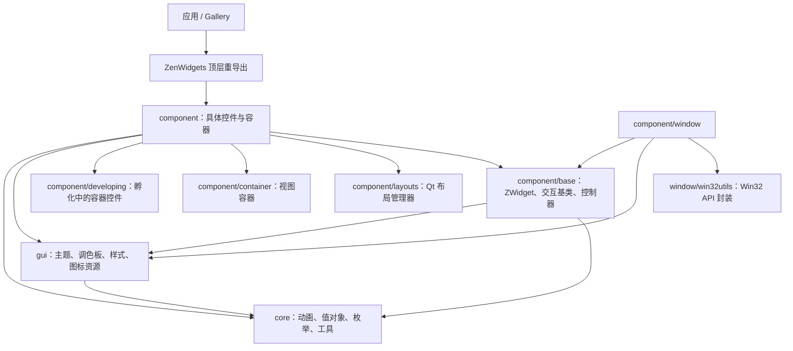
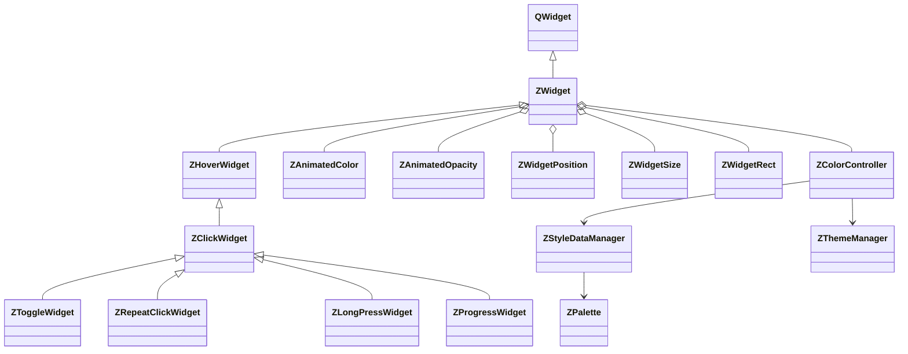
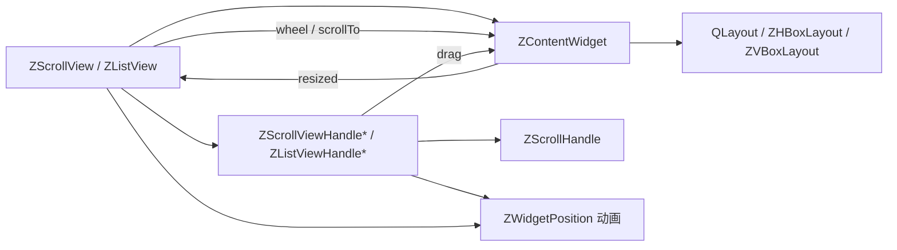

# ZenWidgets 架构说明

本文档描述当前源码中的层次、对象协作、事件/数据流，以及每个 Python 类直接声明的方法。它是面向架构优化的源码索引，不承诺所有列出的方法都是稳定的公共 API。判断以当前工作区实现为准；方法索引通过 Python AST 从库源码、Gallery、示例应用和脚本提取，继承的方法请沿基类继续查阅。

## 1. 总体结构



**依赖方向（源码现状）**

* `component` 是控件实现层；具体控件依赖 `component/base` 提供的基类/控制器，并按需使用 `core`、`gui`。
* `component/layouts` 存放 Qt `QLayout` 子类和 spacer item；它们负责管理 widget 几何，不是可通过父布局 `addWidget()` 加入的 widget。
* `component/container` 当前保留 `ZStackView`、`ZSplitView`、`ZScrollView` 和 `ZListView` 等视图/容器控件。
* `component/developing` 当前放置 `ZHContainer`、dense container 与 flow/masonry container 等仍处于开发命名空间的自定义容器。根级 `component/__init__.py` 仍重导出该包，所以这些类型仍可经 `from ZenWidgets import ...` 导入；Gallery 的新布局用法没有使用它们，不等于包已删除或停止导出它们。
* `core` 放通用动画、数据类型和辅助功能；不承担控件组合或页面布局职责。
* `gui` 集中管理主题、调色板、样式数据、效果和 Qt 资源。颜色数据管理通过 `ZGlobal` 与主题管理关联。
* `component/window/win32utils` 封装 Windows 原生 API；无边框窗口将其与 Qt 窗口/标题栏拼装在一起。
* `zen_widget_gallery` 位于源码包之外，是客户端组合示例，不是 `ZenWidgets` 包的内部层。

> 图表达主要依赖方向，不是完整的逐文件 import 图。下方 AST 索引覆盖当前 `src/ZenWidgets/`、Gallery、示例应用和脚本目录中的 Python 文件；模块级函数、常量以及 PySide6/第三方依赖内部的类不在索引内。

## 2. 核心协作关系

### 2.1 Widget、控制器和主题



`ZWidget` 继承 `QWidget`，是多数自绘组件的共同基础。它通过扫描自身及其 `ZWidget` 子类的类注解，挑出已登记的控制器类型，结合 `__controllers_kwargs__` 创建控制器并缓存解析结果。控制器作为 QObject 子对象关联控件生命周期；`ZWidget` 另行创建窗口透明度、控件大小、控件位置、矩形和透明度控制器。

具有颜色数据的子类通常以 `@colordata_provider(...)` 注册字段模型和主题映射，在类注解中声明 `ZColorController[...]`。`ZWidget._create_controllers_()` 将控制器的 `styleChanged` 信号接到控件 `_color_data_change_handler_()`；控件负责初始化颜色并在变化时更新自己的动画颜色控制器。

主题变化的数据链为：`ZThemeManager.themeChanged` → `ZColorController._theme_change_handler_()` → `ZStyleDataManager.getStyleData(...)` 或自定义颜色数据 → `ZColorController.styleChanged` → 控件颜色回调 → `update()`/动画重绘。`ZStyleDataManager` 维护 provider、缓存和主题变化处理；`ZPalette` 提供全局颜色值。

`ZGlobal` 提供共享的 `themeManager`、`styleDataManager`、`palette`、图标包和 tooltip 入口。`core/globals.py` 在模块加载时调用 `ZGlobal.initZenWidgets()`，因此首次导入链包含全局初始化（日志和调色板），并非纯声明式导入。

### 2.2 输入控件的交互继承链

```text
QWidget
└─ ZWidget
   └─ ZHoverWidget       hover 状态 / enter-leave 分发
      └─ ZClickWidget   press-release-click 流程
         ├─ ZToggleWidget       checked 状态、可取消状态、互斥组
         ├─ ZRepeatClickWidget  按压重复触发
         ├─ ZLongPressWidget    长按/进度处理
         └─ ZProgressWidget     进度状态
```

`ZButton`、`ZRepeatButton`、`ZToggleButton`、`ZSwitch` 等具体控件继承这些行为基类，再补充自身属性、颜色映射和 `paintEvent`。`ZExclusiveToggleGroup` 通过注册控件和 toggle 事件提供互斥选择；`ZNavigationBar` 使用它管理导航选择状态。

### 2.3 容器、内容区和滚动手柄



`ZScrollView` 组合内容 widget、水平/垂直手柄，监听内容尺寸变化后更新手柄长度/位置；滚轮和 `scrollTo` 移动内容，手柄拖动则反向更新内容偏移。`ZListView` 按方向只创建一个手柄，并替内容区设置水平或垂直布局。手柄类共享 `ZScrollHandle` 的绘制/显隐/交互行为，具体方向子类处理拖拽映射。

布局与容器需区分：`ZHBoxLayout`/`ZVBoxLayout`/`ZFlowLayout` 是 `QLayout` 类型，应通过 `QWidget.setLayout()`、`QLayout.addLayout()` 安装到 widget/layout；不能当成 `QWidget` 交给 `addWidget()`。`ZHContainer`/`ZVContainer`、`ZHDenseContainer`/`ZVDenseContainer`、`ZFlowContainer`/`ZMasonryContainer` 则是 `component/developing/` 下的独立 widget 容器，负责自行管理子控件的位置和几何；其中 dense/flow 基类直接继承 `QWidget`，horizontal/vertical container 继承 `ZWidget`。滚动视图的 viewport/content 机制是另一层关注点。

### 2.4 导航栏、菜单和窗口

* `ZNavigationBar` 组合 `Panel`、`FooterPanel`、`Indicator`、导航按钮和 `ZExclusiveToggleGroup`。按钮存放在 panel 的布局中；toggle group 发出选择变化后更新 indicator，panel 滚动后重新同步 indicator。Gallery 通过导航按钮的 `clicked` 信号切换 `ZStackView` 当前页面。
* Gallery 的当前结构主要用 `ZVBoxLayout`/`ZHBoxLayout` 安排页面、卡片与控件；组件子包已将通用布局和试验容器分开。此前由自定义 container 承担的流式排列/拖动能力并不会自动由 `ZFlowLayout` 提供，二者 API 与职责不同。
* 菜单的数据/视图分离为 `ZAction`、`ZMenuItem`、`ZMenu`：`ZAction` 保存标签、值、图标、快捷键、子菜单和触发信号；`ZMenu` 创建/维护 action 对应的菜单项，处理子菜单打开/关闭、键盘和鼠标事件；`ZMenubar` 管理菜单栏项并驱动菜单显示。`ZContextMenu` 基于 `ZMenu` 扩展事件过滤。
* `ZFramelessWindow` 继承原生 `QWidget` 而非 `ZWidget`，持有 `WindowsWindowEffect`、窗口背景颜色控制器与 `ZColorController`；`nativeEvent` 处理 Win32 非客户区命中测试、最大化边界及焦点边框效果。`ZStandardFramelessWindow` 再组合 `ZTitleBar` 和中心内容区域，并设置共享 tooltip。
* `ZTitleBar` 建立在 `ZTitleBarBase` 上，组合关闭、最大化、最小化、主题切换按钮。窗口特效/任务栏辅助由 `win32utils` 内部函数及 `WinTaskbar` 提供。此层是平台耦合最集中的区域。

### 2.5 文本编辑控件

`ZLineEdit`、`ZLoginEdit`、`ZNumberEdit` 是独立自绘实现，不是彼此继承的通用编辑控件层次。源码中可见它们各自实现光标、选择区、剪贴板、撤销/重做、键盘和鼠标事件；`ZLoginEdit`、`ZNumberEdit` 另外实现输入校验/字符过滤，`ZNumberEdit` 还提供数值步进。`ZTextSnapshot` 是文本编辑历史快照值对象。若要降低重复维护成本，可以先比较三类编辑器的状态模型和输入规则，再考虑抽取纯文本编辑模型或小型 mixin；避免把数字/登录校验与通用编辑行为强耦合。

## 3. 可用于架构优化的观察点

以下是从当前实现可直接验证的结构事实，不等同于必须实施的重构方案：

1. **全局状态与导入副作用**：`ZGlobal` 集中保存主题/样式/图标/tooltip 服务，`initZenWidgets()` 在模块导入期间执行。可评估显式初始化入口与依赖注入，尤其是测试、预览和跨平台导入场景。
2. **UI 与平台适配耦合**：主题读取使用 Windows 注册表；无边框窗口直接组合 Win32 API 与 HWND 消息。可为平台能力定义窄接口，将 Win32 实现与通用 QWidget 外观分隔。
3. **颜色数据注册/异常路径**：provider、dataclass 注册、默认字段推断、缓存、主题变更由 `gui/colordata.py` 和 `ZColorController` 共同承担。建议明确 provider 生命周期/缓存失效规则；注意当前 `ZStyleDataManager.getStyleData()` 在 provider 失败时记录异常后回退默认数据，调试 provider 故障时应检查日志。
4. **编辑器行为重复**：几个自绘文本编辑器存在相似的选择/撤销/光标逻辑，但其输入校验不同。可先提取共享状态机/编辑缓冲区并保留各自渲染与规则。
5. **相似滚动逻辑**：`ZScrollView` 与 `ZListView` 都维护内容偏移、滚动手柄和滚轮。若统一逻辑，应先明确双轴/单轴、布局约束及手柄显隐行为差异。
6. **直接继承 QWidget 的容器**：dense/flow 容器绕过 `ZWidget` 的状态和 controller 机制。应确认这是性能/行为设计还是历史差异，再决定是否统一基类。
7. **Gallery 布局与容器能力边界**：`ZFlowLayout` 继承 `QLayout`，不是 `QWidget`，也没有 `regDraggableWidget()`。当前 Gallery 和 PortableBox 将其作为 layout 安装，并不再包含旧流式容器提供的拖动重排行为；若产品仍需要该交互，应由容器/独立交互层负责，而不是把它假定为布局管理器的能力。
8. **可维护性细节**：`ZListView` 当前类体声明了两次 `resizeEvent`；Python 后一个定义覆盖前一个定义，需确认前一份逻辑是否已冗余或有意保留。
9. **类索引边界**：索引列出每个类直接声明的方法名；继承实现、装饰器运行时注入的方法、模块级函数和动态信号/属性不一定出现在该列表中。分析调用关系时需回到源文件或使用 IDE 的引用/调用层级。

## 4. 类与方法索引

下表按源码文件排列。方法名按类体中的声明顺序列出，每个方法链接到其源码定义行；重载的同名方法只列一次，并标注重载声明数。`{property}`/`{classmethod}`/`{staticmethod}`/`{abstractmethod}` 表示 AST 可识别的装饰器。`-` 表示该类没有直接声明方法；它可能仍有继承方法、Qt 元属性、信号或 dataclass 自动生成成员。

<!-- GENERATED CLASS INDEX -->

Index totals: **121 current Python files in the library, Gallery, sample apps, and scripts; 224 classes; 1674 direct method definitions**.

### `src/ZenWidgets/component/base/controller/color.py`

| Class | Direct bases | Direct methods (source order; links open definitions) |
| --- | --- | --- |
| [ABCAnimatedColor](../src/ZenWidgets/component/base/controller/color.py#L18) | `QObject` | [__init__()](../src/ZenWidgets/component/base/controller/color.py#L22), [animation()](../src/ZenWidgets/component/base/controller/color.py#L29){property}, [animationAlpha()](../src/ZenWidgets/component/base/controller/color.py#L32){property}, [_update_()](../src/ZenWidgets/component/base/controller/color.py#L34), [getColor()](../src/ZenWidgets/component/base/controller/color.py#L36), [setColor()](../src/ZenWidgets/component/base/controller/color.py#L38), [getAlphaF()](../src/ZenWidgets/component/base/controller/color.py#L42), [setAlphaF()](../src/ZenWidgets/component/base/controller/color.py#L44)<br>[transparent()](../src/ZenWidgets/component/base/controller/color.py#L48), [opaque()](../src/ZenWidgets/component/base/controller/color.py#L50), [stopAnimation()](../src/ZenWidgets/component/base/controller/color.py#L52), [stopAnimationAlpha()](../src/ZenWidgets/component/base/controller/color.py#L54), [setColorTo()](../src/ZenWidgets/component/base/controller/color.py#L57) (2 overload declarations), [setAlphaTo()](../src/ZenWidgets/component/base/controller/color.py#L73) (2 overload declarations), [setAlphaFTo()](../src/ZenWidgets/component/base/controller/color.py#L89) (2 overload declarations), [toTransparent()](../src/ZenWidgets/component/base/controller/color.py#L104)<br>[toOpaque()](../src/ZenWidgets/component/base/controller/color.py#L107) |
| [ZAnimatedColor](../src/ZenWidgets/component/base/controller/color.py#L112) | `ABCAnimatedColor` | [__init__()](../src/ZenWidgets/component/base/controller/color.py#L114), [animation()](../src/ZenWidgets/component/base/controller/color.py#L124){property}, [animationAlpha()](../src/ZenWidgets/component/base/controller/color.py#L127){property}, [_update_()](../src/ZenWidgets/component/base/controller/color.py#L129), [parent()](../src/ZenWidgets/component/base/controller/color.py#L131) |
| [ZAnimatedLinearGradient](../src/ZenWidgets/component/base/controller/color.py#L136) | `QObject` | [__init__()](../src/ZenWidgets/component/base/controller/color.py#L138), [start()](../src/ZenWidgets/component/base/controller/color.py#L147){property}, [end()](../src/ZenWidgets/component/base/controller/color.py#L150){property}, [direction()](../src/ZenWidgets/component/base/controller/color.py#L153){property} (2 definitions), [reverse()](../src/ZenWidgets/component/base/controller/color.py#L170){property} (2 definitions), [linearPoints()](../src/ZenWidgets/component/base/controller/color.py#L179){property} (2 definitions), [parent()](../src/ZenWidgets/component/base/controller/color.py#L187) |
| [ZWindowBackGround](../src/ZenWidgets/component/base/controller/color.py#L192) | `ABCAnimatedColor` | [__init__()](../src/ZenWidgets/component/base/controller/color.py#L194), [animation()](../src/ZenWidgets/component/base/controller/color.py#L204){property}, [animationAlpha()](../src/ZenWidgets/component/base/controller/color.py#L207){property}, [_update_()](../src/ZenWidgets/component/base/controller/color.py#L209), [parent()](../src/ZenWidgets/component/base/controller/color.py#L212) |

### `src/ZenWidgets/component/base/controller/colordata.py`

| Class | Direct bases | Direct methods (source order; links open definitions) |
| --- | --- | --- |
| [ZColorController](../src/ZenWidgets/component/base/controller/colordata.py#L11) | `QObject, Generic[ColorDataT]` | [__init__()](../src/ZenWidgets/component/base/controller/colordata.py#L17), [data()](../src/ZenWidgets/component/base/controller/colordata.py#L27){property}, [_theme_change_handler_()](../src/ZenWidgets/component/base/controller/colordata.py#L30), [setKey()](../src/ZenWidgets/component/base/controller/colordata.py#L40), [setCustomDataComplete()](../src/ZenWidgets/component/base/controller/colordata.py#L52), [setCustomData()](../src/ZenWidgets/component/base/controller/colordata.py#L67), [setDefault()](../src/ZenWidgets/component/base/controller/colordata.py#L89) |

### `src/ZenWidgets/component/base/controller/effect.py`

| Class | Direct bases | Direct methods (source order; links open definitions) |
| --- | --- | --- |
| [ABCAnimatedEffect](../src/ZenWidgets/component/base/controller/effect.py#L12) | `QObject` | [__init__()](../src/ZenWidgets/component/base/controller/effect.py#L13), [animation()](../src/ZenWidgets/component/base/controller/effect.py#L21){property}, [getAlphaF()](../src/ZenWidgets/component/base/controller/effect.py#L23), [setAlphaF()](../src/ZenWidgets/component/base/controller/effect.py#L25), [getColor()](../src/ZenWidgets/component/base/controller/effect.py#L29), [setColor()](../src/ZenWidgets/component/base/controller/effect.py#L31), [parent()](../src/ZenWidgets/component/base/controller/effect.py#L35), [stopAnimation()](../src/ZenWidgets/component/base/controller/effect.py#L37) |
| [ZFlashEffect](../src/ZenWidgets/component/base/controller/effect.py#L40) | `ABCAnimatedEffect` | [__init__()](../src/ZenWidgets/component/base/controller/effect.py#L42), [flash()](../src/ZenWidgets/component/base/controller/effect.py#L48), [drawFlashLayer()](../src/ZenWidgets/component/base/controller/effect.py#L58) |
| [ZOpacityEffect](../src/ZenWidgets/component/base/controller/effect.py#L67) | `ABCAnimatedEffect` | [setAlphaTo()](../src/ZenWidgets/component/base/controller/effect.py#L69), [setAlphaFTo()](../src/ZenWidgets/component/base/controller/effect.py#L75), [toTransparent()](../src/ZenWidgets/component/base/controller/effect.py#L81), [drawOpacityLayer()](../src/ZenWidgets/component/base/controller/effect.py#L87) |

### `src/ZenWidgets/component/base/controller/opacity.py`

| Class | Direct bases | Direct methods (source order; links open definitions) |
| --- | --- | --- |
| [ABCAnimatedOpacity](../src/ZenWidgets/component/base/controller/opacity.py#L13) | `QObject` | [__init__()](../src/ZenWidgets/component/base/controller/opacity.py#L18), [animation()](../src/ZenWidgets/component/base/controller/opacity.py#L23){property}, [getOpacity()](../src/ZenWidgets/component/base/controller/opacity.py#L25), [setOpacity()](../src/ZenWidgets/component/base/controller/opacity.py#L27), [fadeTo()](../src/ZenWidgets/component/base/controller/opacity.py#L32) (2 overload declarations), [fadeIn()](../src/ZenWidgets/component/base/controller/opacity.py#L46), [fadeOut()](../src/ZenWidgets/component/base/controller/opacity.py#L51), [_on_finished_()](../src/ZenWidgets/component/base/controller/opacity.py#L56)<br>[parent()](../src/ZenWidgets/component/base/controller/opacity.py#L62) |
| [ZAnimatedOpacity](../src/ZenWidgets/component/base/controller/opacity.py#L66) | `ABCAnimatedOpacity` | [__init__()](../src/ZenWidgets/component/base/controller/opacity.py#L68), [animation()](../src/ZenWidgets/component/base/controller/opacity.py#L77){property}, [getOpacity()](../src/ZenWidgets/component/base/controller/opacity.py#L79), [setOpacity()](../src/ZenWidgets/component/base/controller/opacity.py#L81) |
| [ZWindowOpacity](../src/ZenWidgets/component/base/controller/opacity.py#L88) | `ABCAnimatedOpacity` | [__init__()](../src/ZenWidgets/component/base/controller/opacity.py#L90), [animation()](../src/ZenWidgets/component/base/controller/opacity.py#L98){property}, [getOpacity()](../src/ZenWidgets/component/base/controller/opacity.py#L100), [setOpacity()](../src/ZenWidgets/component/base/controller/opacity.py#L102) |

### `src/ZenWidgets/component/base/controller/position.py`

| Class | Direct bases | Direct methods (source order; links open definitions) |
| --- | --- | --- |
| [ABCAnimatedPoint](../src/ZenWidgets/component/base/controller/position.py#L14) | `QObject` | [__init__()](../src/ZenWidgets/component/base/controller/position.py#L17), [animation()](../src/ZenWidgets/component/base/controller/position.py#L22){property}, [getPos()](../src/ZenWidgets/component/base/controller/position.py#L24), [setPos()](../src/ZenWidgets/component/base/controller/position.py#L26), [moveTo()](../src/ZenWidgets/component/base/controller/position.py#L31) (2 overload declarations), [moveFromTo()](../src/ZenWidgets/component/base/controller/position.py#L41), [moveBy()](../src/ZenWidgets/component/base/controller/position.py#L47), [parent()](../src/ZenWidgets/component/base/controller/position.py#L52) |
| [ZWidgetPosition](../src/ZenWidgets/component/base/controller/position.py#L56) | `ABCAnimatedPoint` | [__init__()](../src/ZenWidgets/component/base/controller/position.py#L58), [getPos()](../src/ZenWidgets/component/base/controller/position.py#L64), [setPos()](../src/ZenWidgets/component/base/controller/position.py#L66) |
| [ZAnimatedPoint](../src/ZenWidgets/component/base/controller/position.py#L71) | `ABCAnimatedPoint` | [__init__()](../src/ZenWidgets/component/base/controller/position.py#L73), [getPos()](../src/ZenWidgets/component/base/controller/position.py#L80), [setPos()](../src/ZenWidgets/component/base/controller/position.py#L82) |
| [ZAnimatedPointF](../src/ZenWidgets/component/base/controller/position.py#L90) | `QObject` | [__init__()](../src/ZenWidgets/component/base/controller/position.py#L94), [animation()](../src/ZenWidgets/component/base/controller/position.py#L102){property}, [getPos()](../src/ZenWidgets/component/base/controller/position.py#L104), [setPos()](../src/ZenWidgets/component/base/controller/position.py#L106), [moveTo()](../src/ZenWidgets/component/base/controller/position.py#L113) (2 overload declarations), [moveFromTo()](../src/ZenWidgets/component/base/controller/position.py#L123), [moveBy()](../src/ZenWidgets/component/base/controller/position.py#L129), [parent()](../src/ZenWidgets/component/base/controller/position.py#L135) |

### `src/ZenWidgets/component/base/controller/rect.py`

| Class | Direct bases | Direct methods (source order; links open definitions) |
| --- | --- | --- |
| [ABCAnimatedRect](../src/ZenWidgets/component/base/controller/rect.py#L13) | `QObject` | [__init__()](../src/ZenWidgets/component/base/controller/rect.py#L15), [animation()](../src/ZenWidgets/component/base/controller/rect.py#L20){property}, [getRect()](../src/ZenWidgets/component/base/controller/rect.py#L23), [setRect()](../src/ZenWidgets/component/base/controller/rect.py#L26), [moveResizeTo()](../src/ZenWidgets/component/base/controller/rect.py#L32) (2 overload declarations), [moveResizeFromTo()](../src/ZenWidgets/component/base/controller/rect.py#L45), [scaleIn()](../src/ZenWidgets/component/base/controller/rect.py#L51), [scaleOut()](../src/ZenWidgets/component/base/controller/rect.py#L59)<br>[parent()](../src/ZenWidgets/component/base/controller/rect.py#L68) |
| [ZWidgetRect](../src/ZenWidgets/component/base/controller/rect.py#L73) | `ABCAnimatedRect` | [__init__()](../src/ZenWidgets/component/base/controller/rect.py#L75), [getRect()](../src/ZenWidgets/component/base/controller/rect.py#L81), [setRect()](../src/ZenWidgets/component/base/controller/rect.py#L84) |
| [ZAnimatedRect](../src/ZenWidgets/component/base/controller/rect.py#L91) | `ABCAnimatedRect` | [__init__()](../src/ZenWidgets/component/base/controller/rect.py#L93), [animation()](../src/ZenWidgets/component/base/controller/rect.py#L101){property}, [getRect()](../src/ZenWidgets/component/base/controller/rect.py#L104), [setRect()](../src/ZenWidgets/component/base/controller/rect.py#L107) |

### `src/ZenWidgets/component/base/controller/size.py`

| Class | Direct bases | Direct methods (source order; links open definitions) |
| --- | --- | --- |
| [ABCAnimatedSize](../src/ZenWidgets/component/base/controller/size.py#L13) | `QObject` | [__init__()](../src/ZenWidgets/component/base/controller/size.py#L15), [animation()](../src/ZenWidgets/component/base/controller/size.py#L20){property}, [getSize()](../src/ZenWidgets/component/base/controller/size.py#L22), [setSize()](../src/ZenWidgets/component/base/controller/size.py#L24), [resizeTo()](../src/ZenWidgets/component/base/controller/size.py#L30) (2 overload declarations), [resizeFromTo()](../src/ZenWidgets/component/base/controller/size.py#L40), [parent()](../src/ZenWidgets/component/base/controller/size.py#L46) |
| [ZWidgetSize](../src/ZenWidgets/component/base/controller/size.py#L51) | `ABCAnimatedSize` | [__init__()](../src/ZenWidgets/component/base/controller/size.py#L53), [getSize()](../src/ZenWidgets/component/base/controller/size.py#L60), [setSize()](../src/ZenWidgets/component/base/controller/size.py#L62) |
| [ZAnimatedSize](../src/ZenWidgets/component/base/controller/size.py#L67) | `ABCAnimatedSize` | [__init__()](../src/ZenWidgets/component/base/controller/size.py#L69), [animation()](../src/ZenWidgets/component/base/controller/size.py#L77){property}, [getSize()](../src/ZenWidgets/component/base/controller/size.py#L79), [setSize()](../src/ZenWidgets/component/base/controller/size.py#L81) |

### `src/ZenWidgets/component/base/controller/value.py`

| Class | Direct bases | Direct methods (source order; links open definitions) |
| --- | --- | --- |
| [ABCAnimatedInt](../src/ZenWidgets/component/base/controller/value.py#L14) | `QObject` | [__init__()](../src/ZenWidgets/component/base/controller/value.py#L16), [animation()](../src/ZenWidgets/component/base/controller/value.py#L22){property}, [getValue()](../src/ZenWidgets/component/base/controller/value.py#L24), [setValue()](../src/ZenWidgets/component/base/controller/value.py#L26), [setValueTo()](../src/ZenWidgets/component/base/controller/value.py#L33) (2 overload declarations), [parent()](../src/ZenWidgets/component/base/controller/value.py#L48) |
| [ZAnimatedInt](../src/ZenWidgets/component/base/controller/value.py#L52) | `ABCAnimatedInt` | [__init__()](../src/ZenWidgets/component/base/controller/value.py#L54), [animation()](../src/ZenWidgets/component/base/controller/value.py#L61){property} |
| [ABCAnimatedFloat](../src/ZenWidgets/component/base/controller/value.py#L64) | `QObject` | [__init__()](../src/ZenWidgets/component/base/controller/value.py#L66), [animation()](../src/ZenWidgets/component/base/controller/value.py#L72){property}, [getValue()](../src/ZenWidgets/component/base/controller/value.py#L74), [setValue()](../src/ZenWidgets/component/base/controller/value.py#L76), [setValueTo()](../src/ZenWidgets/component/base/controller/value.py#L83) (2 overload declarations), [parent()](../src/ZenWidgets/component/base/controller/value.py#L98) |
| [ZAnimatedFloat](../src/ZenWidgets/component/base/controller/value.py#L102) | `ABCAnimatedFloat` | [__init__()](../src/ZenWidgets/component/base/controller/value.py#L104), [animation()](../src/ZenWidgets/component/base/controller/value.py#L111){property} |

### `src/ZenWidgets/component/base/group/group.py`

| Class | Direct bases | Direct methods (source order; links open definitions) |
| --- | --- | --- |
| [ZExclusiveToggleGroup](../src/ZenWidgets/component/base/group/group.py#L8) | `QObject` | [__init__()](../src/ZenWidgets/component/base/group/group.py#L12), [_widget_toggle_handler_()](../src/ZenWidgets/component/base/group/group.py#L26), [isEnabled()](../src/ZenWidgets/component/base/group/group.py#L42), [setEnabled()](../src/ZenWidgets/component/base/group/group.py#L44), [widgets()](../src/ZenWidgets/component/base/group/group.py#L49), [checkedKey()](../src/ZenWidgets/component/base/group/group.py#L51), [checkedWidget()](../src/ZenWidgets/component/base/group/group.py#L53), [lastCheckedKey()](../src/ZenWidgets/component/base/group/group.py#L55)<br>[lastCheckedWidget()](../src/ZenWidgets/component/base/group/group.py#L57), [count()](../src/ZenWidgets/component/base/group/group.py#L59), [allowUncheck()](../src/ZenWidgets/component/base/group/group.py#L61), [setAllowUncheck()](../src/ZenWidgets/component/base/group/group.py#L63), [getWidget()](../src/ZenWidgets/component/base/group/group.py#L68), [addWidget()](../src/ZenWidgets/component/base/group/group.py#L70), [removeWidget()](../src/ZenWidgets/component/base/group/group.py#L103) (2 overload declarations), [toggleTo()](../src/ZenWidgets/component/base/group/group.py#L137)<br>[toggleToNext()](../src/ZenWidgets/component/base/group/group.py#L153), [toggleToLast()](../src/ZenWidgets/component/base/group/group.py#L164) |

### `src/ZenWidgets/component/base/widget/widget.py`

| Class | Direct bases | Direct methods (source order; links open definitions) |
| --- | --- | --- |
| [ZWidget](../src/ZenWidgets/component/base/widget/widget.py#L42) | `QWidget, Generic[StyleT]` | [__init__()](../src/ZenWidgets/component/base/widget/widget.py#L68), [windowOpacityCtrl()](../src/ZenWidgets/component/base/widget/widget.py#L100){property}, [widgetSizeCtrl()](../src/ZenWidgets/component/base/widget/widget.py#L103){property}, [widgetPositionCtrl()](../src/ZenWidgets/component/base/widget/widget.py#L106){property}, [widgetRectCtrl()](../src/ZenWidgets/component/base/widget/widget.py#L109){property}, [opacityCtrl()](../src/ZenWidgets/component/base/widget/widget.py#L112){property}, [_resolve_controllers_()](../src/ZenWidgets/component/base/widget/widget.py#L116){classmethod}, [_create_controllers_()](../src/ZenWidgets/component/base/widget/widget.py#L142)<br>[_init_color_data_()](../src/ZenWidgets/component/base/widget/widget.py#L152), [_color_data_change_handler_()](../src/ZenWidgets/component/base/widget/widget.py#L154), [_show_tooltip_()](../src/ZenWidgets/component/base/widget/widget.py#L156), [_hide_tooltip_()](../src/ZenWidgets/component/base/widget/widget.py#L158), [_init_style_()](../src/ZenWidgets/component/base/widget/widget.py#L160), [_update_style_()](../src/ZenWidgets/component/base/widget/widget.py#L162), [state()](../src/ZenWidgets/component/base/widget/widget.py#L166), [style()](../src/ZenWidgets/component/base/widget/widget.py#L169)<br>[moveAnchor()](../src/ZenWidgets/component/base/widget/widget.py#L171), [isPressed()](../src/ZenWidgets/component/base/widget/widget.py#L173), [isHover()](../src/ZenWidgets/component/base/widget/widget.py#L175), [isHidden()](../src/ZenWidgets/component/base/widget/widget.py#L177), [isShowing()](../src/ZenWidgets/component/base/widget/widget.py#L179), [isDraggable()](../src/ZenWidgets/component/base/widget/widget.py#L181), [isMoving()](../src/ZenWidgets/component/base/widget/widget.py#L183), [isResizing()](../src/ZenWidgets/component/base/widget/widget.py#L185)<br>[isFading()](../src/ZenWidgets/component/base/widget/widget.py#L187), [isWindowFading()](../src/ZenWidgets/component/base/widget/widget.py#L189), [hasHeightForWidth()](../src/ZenWidgets/component/base/widget/widget.py#L192), [setHeightForWidth()](../src/ZenWidgets/component/base/widget/widget.py#L194), [heightHint()](../src/ZenWidgets/component/base/widget/widget.py#L197), [widthHint()](../src/ZenWidgets/component/base/widget/widget.py#L199), [setDraggable()](../src/ZenWidgets/component/base/widget/widget.py#L201), [setStyle()](../src/ZenWidgets/component/base/widget/widget.py#L205)<br>[setMoveAnchor()](../src/ZenWidgets/component/base/widget/widget.py#L212) (2 overload declarations), [moveTo()](../src/ZenWidgets/component/base/widget/widget.py#L219) (2 overload declarations), [resizeTo()](../src/ZenWidgets/component/base/widget/widget.py#L226) (2 overload declarations), [move()](../src/ZenWidgets/component/base/widget/widget.py#L233) (2 overload declarations), [fadeIn()](../src/ZenWidgets/component/base/widget/widget.py#L240), [fadeOut()](../src/ZenWidgets/component/base/widget/widget.py#L242), [windowFadeIn()](../src/ZenWidgets/component/base/widget/widget.py#L244), [windowFadeOut()](../src/ZenWidgets/component/base/widget/widget.py#L246)<br>[setEnabled()](../src/ZenWidgets/component/base/widget/widget.py#L249), [parentWidget()](../src/ZenWidgets/component/base/widget/widget.py#L256), [layout()](../src/ZenWidgets/component/base/widget/widget.py#L259), [event()](../src/ZenWidgets/component/base/widget/widget.py#L263), [moveEvent()](../src/ZenWidgets/component/base/widget/widget.py#L268), [resizeEvent()](../src/ZenWidgets/component/base/widget/widget.py#L273), [mousePressEvent()](../src/ZenWidgets/component/base/widget/widget.py#L278), [mouseMoveEvent()](../src/ZenWidgets/component/base/widget/widget.py#L284) |
| [ZPlaceHolderWidget](../src/ZenWidgets/component/base/widget/widget.py#L293) | `ZWidget` | - |
| [ZContentWidget](../src/ZenWidgets/component/base/widget/widget.py#L299) | `ZWidget` | - |
| [ZHoverWidget](../src/ZenWidgets/component/base/widget/widget.py#L304) | `ZWidget[StyleT]` | [__init__()](../src/ZenWidgets/component/base/widget/widget.py#L307), [_mouse_enter_()](../src/ZenWidgets/component/base/widget/widget.py#L323), [_mouse_leave_()](../src/ZenWidgets/component/base/widget/widget.py#L325), [enterEvent()](../src/ZenWidgets/component/base/widget/widget.py#L328), [leaveEvent()](../src/ZenWidgets/component/base/widget/widget.py#L335) |
| [ZClickWidget](../src/ZenWidgets/component/base/widget/widget.py#L342) | `ZHoverWidget[StyleT]` | [__init__()](../src/ZenWidgets/component/base/widget/widget.py#L346), [_mouse_click_()](../src/ZenWidgets/component/base/widget/widget.py#L363), [_mouse_press_()](../src/ZenWidgets/component/base/widget/widget.py#L365), [_mouse_release_()](../src/ZenWidgets/component/base/widget/widget.py#L367), [mousePressEvent()](../src/ZenWidgets/component/base/widget/widget.py#L371), [mouseMoveEvent()](../src/ZenWidgets/component/base/widget/widget.py#L379), [mouseReleaseEvent()](../src/ZenWidgets/component/base/widget/widget.py#L400) |
| [ZToggleWidget](../src/ZenWidgets/component/base/widget/widget.py#L414) | `ZClickWidget[StyleT]` | [__init__()](../src/ZenWidgets/component/base/widget/widget.py#L416), [_toggle_()](../src/ZenWidgets/component/base/widget/widget.py#L440), [isChecked()](../src/ZenWidgets/component/base/widget/widget.py#L443), [setChecked()](../src/ZenWidgets/component/base/widget/widget.py#L445), [isCheckable()](../src/ZenWidgets/component/base/widget/widget.py#L451), [setCheckable()](../src/ZenWidgets/component/base/widget/widget.py#L453), [allowUncheck()](../src/ZenWidgets/component/base/widget/widget.py#L455), [setAllowUncheck()](../src/ZenWidgets/component/base/widget/widget.py#L457)<br>[setGroup()](../src/ZenWidgets/component/base/widget/widget.py#L459), [unsetGroup()](../src/ZenWidgets/component/base/widget/widget.py#L462), [mouseReleaseEvent()](../src/ZenWidgets/component/base/widget/widget.py#L467) |
| [ZRepeatClickWidget](../src/ZenWidgets/component/base/widget/widget.py#L476) | `ZClickWidget[StyleT]` | [__init__()](../src/ZenWidgets/component/base/widget/widget.py#L477), [_mouse_repeat_click_handler_()](../src/ZenWidgets/component/base/widget/widget.py#L510), [isRepeatable()](../src/ZenWidgets/component/base/widget/widget.py#L517), [setRepeatable()](../src/ZenWidgets/component/base/widget/widget.py#L519), [repeatCount()](../src/ZenWidgets/component/base/widget/widget.py#L521), [triggerInterval()](../src/ZenWidgets/component/base/widget/widget.py#L523), [setTriggerInterval()](../src/ZenWidgets/component/base/widget/widget.py#L525), [triggerDelay()](../src/ZenWidgets/component/base/widget/widget.py#L527)<br>[setTriggerDelay()](../src/ZenWidgets/component/base/widget/widget.py#L529), [mousePressEvent()](../src/ZenWidgets/component/base/widget/widget.py#L533), [mouseMoveEvent()](../src/ZenWidgets/component/base/widget/widget.py#L539), [mouseReleaseEvent()](../src/ZenWidgets/component/base/widget/widget.py#L547) |
| [ZLongPressWidget](../src/ZenWidgets/component/base/widget/widget.py#L555) | `ZClickWidget[StyleT]` | [__init__()](../src/ZenWidgets/component/base/widget/widget.py#L560), [_mouse_press_()](../src/ZenWidgets/component/base/widget/widget.py#L580), [_mouse_release_()](../src/ZenWidgets/component/base/widget/widget.py#L583), [_step_length_()](../src/ZenWidgets/component/base/widget/widget.py#L586), [_reset_progress_()](../src/ZenWidgets/component/base/widget/widget.py#L591), [_long_press_handler_()](../src/ZenWidgets/component/base/widget/widget.py#L596) |
| [ZProgressWidget](../src/ZenWidgets/component/base/widget/widget.py#L609) | `ZClickWidget[StyleT]` | [__init__()](../src/ZenWidgets/component/base/widget/widget.py#L616), [isResetOnFinish()](../src/ZenWidgets/component/base/widget/widget.py#L634), [setResetOnFinish()](../src/ZenWidgets/component/base/widget/widget.py#L636), [setProgress()](../src/ZenWidgets/component/base/widget/widget.py#L638) |

### `src/ZenWidgets/component/cards/card.py`

| Class | Direct bases | Direct methods (source order; links open definitions) |
| --- | --- | --- |
| [ZCardColorData](../src/ZenWidgets/component/cards/card.py#L15) | `ZColorData` | - |
| [ZCard](../src/ZenWidgets/component/cards/card.py#L34) | `ZWidget` | [__init__()](../src/ZenWidgets/component/cards/card.py#L46), [setShadowDisplay()](../src/ZenWidgets/component/cards/card.py#L65), [setBorderDisplay()](../src/ZenWidgets/component/cards/card.py#L69), [sizeHint()](../src/ZenWidgets/component/cards/card.py#L73), [_init_color_data_()](../src/ZenWidgets/component/cards/card.py#L76), [_color_data_change_handler_()](../src/ZenWidgets/component/cards/card.py#L82), [paintEvent()](../src/ZenWidgets/component/cards/card.py#L89) |

### `src/ZenWidgets/component/container/listview.py`

| Class | Direct bases | Direct methods (source order; links open definitions) |
| --- | --- | --- |
| [ZListView](../src/ZenWidgets/component/container/listview.py#L15) | `ZWidget` | [__init__()](../src/ZenWidgets/component/container/listview.py#L19), [content()](../src/ZenWidgets/component/container/listview.py#L46), [layout()](../src/ZenWidgets/component/container/listview.py#L48), [setLayout()](../src/ZenWidgets/component/container/listview.py#L51), [_update_handle_and_content()](../src/ZenWidgets/component/container/listview.py#L54), [scrollTo()](../src/ZenWidgets/component/container/listview.py#L90), [resizeEvent()](../src/ZenWidgets/component/container/listview.py#L108) (2 definitions), [setHandlesVisible()](../src/ZenWidgets/component/container/listview.py#L118)<br>[showHandle()](../src/ZenWidgets/component/container/listview.py#L122), [hideHandle()](../src/ZenWidgets/component/container/listview.py#L124), [handleVisible()](../src/ZenWidgets/component/container/listview.py#L126), [wheelEvent()](../src/ZenWidgets/component/container/listview.py#L139) |
| [ZVListView](../src/ZenWidgets/component/container/listview.py#L153) | `ZListView` | [__init__()](../src/ZenWidgets/component/container/listview.py#L154) |
| [ZHListView](../src/ZenWidgets/component/container/listview.py#L158) | `ZListView` | [__init__()](../src/ZenWidgets/component/container/listview.py#L159) |

### `src/ZenWidgets/component/container/scrollview.py`

| Class | Direct bases | Direct methods (source order; links open definitions) |
| --- | --- | --- |
| [ZScrollView](../src/ZenWidgets/component/container/scrollview.py#L14) | `ZWidget` | [__init__()](../src/ZenWidgets/component/container/scrollview.py#L15), [content()](../src/ZenWidgets/component/container/scrollview.py#L35), [_sync_scroll_handles()](../src/ZenWidgets/component/container/scrollview.py#L38), [_update_handles_and_content()](../src/ZenWidgets/component/container/scrollview.py#L66), [_update_vertical_handle()](../src/ZenWidgets/component/container/scrollview.py#L73), [_update_horizontal_handle()](../src/ZenWidgets/component/container/scrollview.py#L96), [setHandlesVisible()](../src/ZenWidgets/component/container/scrollview.py#L118), [showHandles()](../src/ZenWidgets/component/container/scrollview.py#L124)<br>[hideHandles()](../src/ZenWidgets/component/container/scrollview.py#L127), [handlesVisible()](../src/ZenWidgets/component/container/scrollview.py#L130), [scrollTo()](../src/ZenWidgets/component/container/scrollview.py#L134), [layout()](../src/ZenWidgets/component/container/scrollview.py#L158), [setLayout()](../src/ZenWidgets/component/container/scrollview.py#L161), [resizeEvent()](../src/ZenWidgets/component/container/scrollview.py#L165), [wheelEvent()](../src/ZenWidgets/component/container/scrollview.py#L175) |

### `src/ZenWidgets/component/container/splitview.py`

| Class | Direct bases | Direct methods (source order; links open definitions) |
| --- | --- | --- |
| [ZSplitView](../src/ZenWidgets/component/container/splitview.py#L6) | `ZWidget` | [__init__()](../src/ZenWidgets/component/container/splitview.py#L8), [setWidgets()](../src/ZenWidgets/component/container/splitview.py#L26), [_on_handle_dragged()](../src/ZenWidgets/component/container/splitview.py#L79), [resizeEvent()](../src/ZenWidgets/component/container/splitview.py#L189), [update_layout()](../src/ZenWidgets/component/container/splitview.py#L193), [sizeHint()](../src/ZenWidgets/component/container/splitview.py#L247) |
| [ZHSplitView](../src/ZenWidgets/component/container/splitview.py#L275) | `ZSplitView` | [__init__()](../src/ZenWidgets/component/container/splitview.py#L276) |
| [ZVSplitView](../src/ZenWidgets/component/container/splitview.py#L280) | `ZSplitView` | [__init__()](../src/ZenWidgets/component/container/splitview.py#L281) |

### `src/ZenWidgets/component/container/stackview.py`

| Class | Direct bases | Direct methods (source order; links open definitions) |
| --- | --- | --- |
| [ZStackView](../src/ZenWidgets/component/container/stackview.py#L7) | `ZWidget` | [__init__()](../src/ZenWidgets/component/container/stackview.py#L8), [currentWidget()](../src/ZenWidgets/component/container/stackview.py#L25), [currentWidgetIndex()](../src/ZenWidgets/component/container/stackview.py#L27), [lastWidget()](../src/ZenWidgets/component/container/stackview.py#L29), [widget()](../src/ZenWidgets/component/container/stackview.py#L32) (2 overload declarations), [widgets()](../src/ZenWidgets/component/container/stackview.py#L44), [widgetCount()](../src/ZenWidgets/component/container/stackview.py#L46), [addWidget()](../src/ZenWidgets/component/container/stackview.py#L48)<br>[removeWidget()](../src/ZenWidgets/component/container/stackview.py#L72) (2 overload declarations), [setCurrentWidget()](../src/ZenWidgets/component/container/stackview.py#L101) (3 overload declarations), [sizeHint()](../src/ZenWidgets/component/container/stackview.py#L146), [resizeEvent()](../src/ZenWidgets/component/container/stackview.py#L153), [paintEvent()](../src/ZenWidgets/component/container/stackview.py#L159) |

### `src/ZenWidgets/component/developing/container.py`

| Class | Direct bases | Direct methods (source order; links open definitions) |
| --- | --- | --- |
| [ZHContainer](../src/ZenWidgets/component/developing/container.py#L15) | `ZWidget` | [__init__()](../src/ZenWidgets/component/developing/container.py#L17), [widgets()](../src/ZenWidgets/component/developing/container.py#L36), [margins()](../src/ZenWidgets/component/developing/container.py#L38), [setMargins()](../src/ZenWidgets/component/developing/container.py#L40), [alignment()](../src/ZenWidgets/component/developing/container.py#L45), [setAlignment()](../src/ZenWidgets/component/developing/container.py#L47), [spacing()](../src/ZenWidgets/component/developing/container.py#L56) (2 overload declarations), [setSpacing()](../src/ZenWidgets/component/developing/container.py#L65) (2 overload declarations)<br>[isExpand()](../src/ZenWidgets/component/developing/container.py#L79), [setExpand()](../src/ZenWidgets/component/developing/container.py#L81), [isMinExpand()](../src/ZenWidgets/component/developing/container.py#L86), [setMinExpand()](../src/ZenWidgets/component/developing/container.py#L88), [usedSpace()](../src/ZenWidgets/component/developing/container.py#L93), [spareSpace()](../src/ZenWidgets/component/developing/container.py#L100), [adjustSize()](../src/ZenWidgets/component/developing/container.py#L105), [sizeHint()](../src/ZenWidgets/component/developing/container.py#L113)<br>[arrangeWidgets()](../src/ZenWidgets/component/developing/container.py#L129), [addWidget()](../src/ZenWidgets/component/developing/container.py#L180), [removeWidget()](../src/ZenWidgets/component/developing/container.py#L205), [eventFilter()](../src/ZenWidgets/component/developing/container.py#L224), [resizeEvent()](../src/ZenWidgets/component/developing/container.py#L229), [paintEvent()](../src/ZenWidgets/component/developing/container.py#L233) |
| [ZVContainer](../src/ZenWidgets/component/developing/container.py#L240) | `ZWidget` | [__init__()](../src/ZenWidgets/component/developing/container.py#L242), [widgets()](../src/ZenWidgets/component/developing/container.py#L261), [margins()](../src/ZenWidgets/component/developing/container.py#L263), [setMargins()](../src/ZenWidgets/component/developing/container.py#L265), [alignment()](../src/ZenWidgets/component/developing/container.py#L270), [setAlignment()](../src/ZenWidgets/component/developing/container.py#L272), [spacing()](../src/ZenWidgets/component/developing/container.py#L281) (2 overload declarations), [setSpacing()](../src/ZenWidgets/component/developing/container.py#L290) (2 overload declarations)<br>[isExpand()](../src/ZenWidgets/component/developing/container.py#L304), [setExpand()](../src/ZenWidgets/component/developing/container.py#L306), [isMinExpand()](../src/ZenWidgets/component/developing/container.py#L311), [setMinExpand()](../src/ZenWidgets/component/developing/container.py#L313), [usedSpace()](../src/ZenWidgets/component/developing/container.py#L318), [spareSpace()](../src/ZenWidgets/component/developing/container.py#L325), [adjustSize()](../src/ZenWidgets/component/developing/container.py#L330), [sizeHint()](../src/ZenWidgets/component/developing/container.py#L338)<br>[arrangeWidgets()](../src/ZenWidgets/component/developing/container.py#L354), [addWidget()](../src/ZenWidgets/component/developing/container.py#L406), [removeWidget()](../src/ZenWidgets/component/developing/container.py#L428), [eventFilter()](../src/ZenWidgets/component/developing/container.py#L445), [resizeEvent()](../src/ZenWidgets/component/developing/container.py#L450), [paintEvent()](../src/ZenWidgets/component/developing/container.py#L454) |

### `src/ZenWidgets/component/developing/densecontainer.py`

| Class | Direct bases | Direct methods (source order; links open definitions) |
| --- | --- | --- |
| [ABCDenseContainer](../src/ZenWidgets/component/developing/densecontainer.py#L13) | `QWidget` | [__init__()](../src/ZenWidgets/component/developing/densecontainer.py#L14), [setUseMoveTo()](../src/ZenWidgets/component/developing/densecontainer.py#L24), [setAdjustWidgetsSize()](../src/ZenWidgets/component/developing/densecontainer.py#L27), [setShrinking()](../src/ZenWidgets/component/developing/densecontainer.py#L31), [setAlignCenter()](../src/ZenWidgets/component/developing/densecontainer.py#L35), [setAlignment()](../src/ZenWidgets/component/developing/densecontainer.py#L41), [alignment()](../src/ZenWidgets/component/developing/densecontainer.py#L44), [setSpacing()](../src/ZenWidgets/component/developing/densecontainer.py#L47)<br>[widgets()](../src/ZenWidgets/component/developing/densecontainer.py#L51), [get_widget_except_placeholders()](../src/ZenWidgets/component/developing/densecontainer.py#L55){staticmethod}, [__enter__()](../src/ZenWidgets/component/developing/densecontainer.py#L62), [__exit__()](../src/ZenWidgets/component/developing/densecontainer.py#L65) |
| [ZHDenseContainer](../src/ZenWidgets/component/developing/densecontainer.py#L69) | `ABCDenseContainer` | [__init__()](../src/ZenWidgets/component/developing/densecontainer.py#L71), [addPlaceholder()](../src/ZenWidgets/component/developing/densecontainer.py#L77), [addWidget()](../src/ZenWidgets/component/developing/densecontainer.py#L84), [getUsedSpace()](../src/ZenWidgets/component/developing/densecontainer.py#L98), [getSpareSpace()](../src/ZenWidgets/component/developing/densecontainer.py#L106), [widgets()](../src/ZenWidgets/component/developing/densecontainer.py#L109), [removeWidget()](../src/ZenWidgets/component/developing/densecontainer.py#L120), [sizeHint()](../src/ZenWidgets/component/developing/densecontainer.py#L134)<br>[arrangeWidget()](../src/ZenWidgets/component/developing/densecontainer.py#L154), [resizeEvent()](../src/ZenWidgets/component/developing/densecontainer.py#L210), [adjustSize()](../src/ZenWidgets/component/developing/densecontainer.py#L214) |
| [ZVDenseContainer](../src/ZenWidgets/component/developing/densecontainer.py#L229) | `ABCDenseContainer` | [__init__()](../src/ZenWidgets/component/developing/densecontainer.py#L232), [addPlaceholder()](../src/ZenWidgets/component/developing/densecontainer.py#L238), [addWidget()](../src/ZenWidgets/component/developing/densecontainer.py#L245), [sizeHint()](../src/ZenWidgets/component/developing/densecontainer.py#L259), [getUsedSpace()](../src/ZenWidgets/component/developing/densecontainer.py#L279), [getSpareSpace()](../src/ZenWidgets/component/developing/densecontainer.py#L287), [widgets()](../src/ZenWidgets/component/developing/densecontainer.py#L290), [removeWidget()](../src/ZenWidgets/component/developing/densecontainer.py#L301)<br>[arrangeWidget()](../src/ZenWidgets/component/developing/densecontainer.py#L315), [resizeEvent()](../src/ZenWidgets/component/developing/densecontainer.py#L371), [adjustSize()](../src/ZenWidgets/component/developing/densecontainer.py#L375) |

### `src/ZenWidgets/component/developing/flowcontainer.py`

| Class | Direct bases | Direct methods (source order; links open definitions) |
| --- | --- | --- |
| [ABCFlowContainer](../src/ZenWidgets/component/developing/flowcontainer.py#L15) | `QWidget` | [__init__()](../src/ZenWidgets/component/developing/flowcontainer.py#L16), [setSpacing()](../src/ZenWidgets/component/developing/flowcontainer.py#L23), [widgets()](../src/ZenWidgets/component/developing/flowcontainer.py#L29), [addWidget()](../src/ZenWidgets/component/developing/flowcontainer.py#L32), [removeWidget()](../src/ZenWidgets/component/developing/flowcontainer.py#L39), [arrangeWidgets()](../src/ZenWidgets/component/developing/flowcontainer.py#L61), [shuffle()](../src/ZenWidgets/component/developing/flowcontainer.py#L64), [swapByIndex()](../src/ZenWidgets/component/developing/flowcontainer.py#L68)<br>[insertToByIndex()](../src/ZenWidgets/component/developing/flowcontainer.py#L75), [regDraggableWidget()](../src/ZenWidgets/component/developing/flowcontainer.py#L87), [_on_widget_dragged()](../src/ZenWidgets/component/developing/flowcontainer.py#L100), [mouseReleaseEvent()](../src/ZenWidgets/component/developing/flowcontainer.py#L116), [resizeEvent()](../src/ZenWidgets/component/developing/flowcontainer.py#L121), [paintEvent()](../src/ZenWidgets/component/developing/flowcontainer.py#L126) |
| [ZFlowContainer](../src/ZenWidgets/component/developing/flowcontainer.py#L134) | `ABCFlowContainer` | [__init__()](../src/ZenWidgets/component/developing/flowcontainer.py#L135), [adjustSize()](../src/ZenWidgets/component/developing/flowcontainer.py#L140), [setLineHeight()](../src/ZenWidgets/component/developing/flowcontainer.py#L143), [arrangeWidgets()](../src/ZenWidgets/component/developing/flowcontainer.py#L148), [sizeHint()](../src/ZenWidgets/component/developing/flowcontainer.py#L191) |
| [ZMasonryContainer](../src/ZenWidgets/component/developing/flowcontainer.py#L195) | `ABCFlowContainer` | [__init__()](../src/ZenWidgets/component/developing/flowcontainer.py#L196), [setAutoAdjustColumnAmount()](../src/ZenWidgets/component/developing/flowcontainer.py#L203), [setColumns()](../src/ZenWidgets/component/developing/flowcontainer.py#L206), [setColumnWidth()](../src/ZenWidgets/component/developing/flowcontainer.py#L209), [arrangeWidgets()](../src/ZenWidgets/component/developing/flowcontainer.py#L212), [adjustColumnAmount()](../src/ZenWidgets/component/developing/flowcontainer.py#L245), [calculateColumnAmount()](../src/ZenWidgets/component/developing/flowcontainer.py#L255), [adjustSize()](../src/ZenWidgets/component/developing/flowcontainer.py#L260)<br>[resizeEvent()](../src/ZenWidgets/component/developing/flowcontainer.py#L264) |

### `src/ZenWidgets/component/dialogs/dialog.py`

| Class | Direct bases | Direct methods (source order; links open definitions) |
| --- | --- | --- |
| [ZDialogColorData](../src/ZenWidgets/component/dialogs/dialog.py#L23) | `ZColorData` | - |
| [ZDialog](../src/ZenWidgets/component/dialogs/dialog.py#L43) | `ZWidget` | [__init__()](../src/ZenWidgets/component/dialogs/dialog.py#L57), [_init_color_data_()](../src/ZenWidgets/component/dialogs/dialog.py#L110), [_color_data_change_handler_()](../src/ZenWidgets/component/dialogs/dialog.py#L116), [accept()](../src/ZenWidgets/component/dialogs/dialog.py#L122), [reject()](../src/ZenWidgets/component/dialogs/dialog.py#L127), [exec()](../src/ZenWidgets/component/dialogs/dialog.py#L132), [result()](../src/ZenWidgets/component/dialogs/dialog.py#L140), [show()](../src/ZenWidgets/component/dialogs/dialog.py#L142)<br>[sizeHint()](../src/ZenWidgets/component/dialogs/dialog.py#L151), [resizeEvent()](../src/ZenWidgets/component/dialogs/dialog.py#L163), [closeEvent()](../src/ZenWidgets/component/dialogs/dialog.py#L167), [keyPressEvent()](../src/ZenWidgets/component/dialogs/dialog.py#L173), [paintEvent()](../src/ZenWidgets/component/dialogs/dialog.py#L180) |

### `src/ZenWidgets/component/info/tooltip.py`

| Class | Direct bases | Direct methods (source order; links open definitions) |
| --- | --- | --- |
| [ZToolTipColorData](../src/ZenWidgets/component/info/tooltip.py#L21) | `ZColorData` | - |
| [ZToolTip](../src/ZenWidgets/component/info/tooltip.py#L40) | `ZWidget` | [__init__()](../src/ZenWidgets/component/info/tooltip.py#L56), [_init_color_data_()](../src/ZenWidgets/component/info/tooltip.py#L102), [_color_data_change_handler_()](../src/ZenWidgets/component/info/tooltip.py#L108), [_update_pos_for_tracker()](../src/ZenWidgets/component/info/tooltip.py#L114), [_get_initial_pos()](../src/ZenWidgets/component/info/tooltip.py#L117), [_get_pos_should_be_move()](../src/ZenWidgets/component/info/tooltip.py#L176), [mode()](../src/ZenWidgets/component/info/tooltip.py#L248), [position()](../src/ZenWidgets/component/info/tooltip.py#L250)<br>[offset()](../src/ZenWidgets/component/info/tooltip.py#L252), [text()](../src/ZenWidgets/component/info/tooltip.py#L254), [target()](../src/ZenWidgets/component/info/tooltip.py#L256), [setText()](../src/ZenWidgets/component/info/tooltip.py#L258), [showTip()](../src/ZenWidgets/component/info/tooltip.py#L265), [hideTip()](../src/ZenWidgets/component/info/tooltip.py#L303), [hideTipDelayed()](../src/ZenWidgets/component/info/tooltip.py#L308), [adjustSize()](../src/ZenWidgets/component/info/tooltip.py#L312)<br>[heightForWidth()](../src/ZenWidgets/component/info/tooltip.py#L314), [sizeHint()](../src/ZenWidgets/component/info/tooltip.py#L326), [paintEvent()](../src/ZenWidgets/component/info/tooltip.py#L341) |
| [Mode](../src/ZenWidgets/component/info/tooltip.py#L52) | `IntEnum` | - |

### `src/ZenWidgets/component/input/button.py`

| Class | Direct bases | Direct methods (source order; links open definitions) |
| --- | --- | --- |
| [ZButtonColorData](../src/ZenWidgets/component/input/button.py#L26) | `ZColorData` | - |
| [ZButton](../src/ZenWidgets/component/input/button.py#L48) | `ZClickWidget[ZButtonStyle]` | [__init__()](../src/ZenWidgets/component/input/button.py#L61), [_init_color_data_()](../src/ZenWidgets/component/input/button.py#L88), [_color_data_change_handler_()](../src/ZenWidgets/component/input/button.py#L95), [_show_tooltip_()](../src/ZenWidgets/component/input/button.py#L102), [_hide_tooltip_()](../src/ZenWidgets/component/input/button.py#L111), [_mouse_enter_()](../src/ZenWidgets/component/input/button.py#L114), [_mouse_leave_()](../src/ZenWidgets/component/input/button.py#L116), [_mouse_click_()](../src/ZenWidgets/component/input/button.py#L118)<br>[isFlat()](../src/ZenWidgets/component/input/button.py#L121), [text()](../src/ZenWidgets/component/input/button.py#L123), [icon()](../src/ZenWidgets/component/input/button.py#L125), [iconSize()](../src/ZenWidgets/component/input/button.py#L127), [spacing()](../src/ZenWidgets/component/input/button.py#L129), [setText()](../src/ZenWidgets/component/input/button.py#L131), [setIcon()](../src/ZenWidgets/component/input/button.py#L136), [setIconSize()](../src/ZenWidgets/component/input/button.py#L138)<br>[setSpacing()](../src/ZenWidgets/component/input/button.py#L143), [sizeHint()](../src/ZenWidgets/component/input/button.py#L148), [enterEvent()](../src/ZenWidgets/component/input/button.py#L163), [leaveEvent()](../src/ZenWidgets/component/input/button.py#L167), [paintEvent()](../src/ZenWidgets/component/input/button.py#L171) |

### `src/ZenWidgets/component/input/combobox.py`

| Class | Direct bases | Direct methods (source order; links open definitions) |
| --- | --- | --- |
| [ZComboBoxItemColorData](../src/ZenWidgets/component/input/combobox.py#L33) | `ZColorData` | - |
| [ZComboBoxItem](../src/ZenWidgets/component/input/combobox.py#L50) | `ZToggleWidget` | [__init__()](../src/ZenWidgets/component/input/combobox.py#L62), [_init_color_data_()](../src/ZenWidgets/component/input/combobox.py#L83), [_color_data_change_handler_()](../src/ZenWidgets/component/input/combobox.py#L89), [_mouse_enter_()](../src/ZenWidgets/component/input/combobox.py#L95), [_mouse_leave_()](../src/ZenWidgets/component/input/combobox.py#L97), [_mouse_press_()](../src/ZenWidgets/component/input/combobox.py#L99), [_mouse_release_()](../src/ZenWidgets/component/input/combobox.py#L101), [_toggle_()](../src/ZenWidgets/component/input/combobox.py#L103)<br>[text()](../src/ZenWidgets/component/input/combobox.py#L108), [spacing()](../src/ZenWidgets/component/input/combobox.py#L110), [padding()](../src/ZenWidgets/component/input/combobox.py#L112), [setText()](../src/ZenWidgets/component/input/combobox.py#L114), [setSpacing()](../src/ZenWidgets/component/input/combobox.py#L119), [setPadding()](../src/ZenWidgets/component/input/combobox.py#L124), [sizeHint()](../src/ZenWidgets/component/input/combobox.py#L129), [paintEvent()](../src/ZenWidgets/component/input/combobox.py#L143) |
| [ZComboBoxViewColorData](../src/ZenWidgets/component/input/combobox.py#L188) | `ZColorData` | - |
| [ZComboBoxView](../src/ZenWidgets/component/input/combobox.py#L205) | `ZWidget` | [__init__()](../src/ZenWidgets/component/input/combobox.py#L216), [_init_color_data_()](../src/ZenWidgets/component/input/combobox.py#L231), [_color_data_change_handler_()](../src/ZenWidgets/component/input/combobox.py#L236), [_init_items_()](../src/ZenWidgets/component/input/combobox.py#L241), [_item_toggle_handler_()](../src/ZenWidgets/component/input/combobox.py#L251), [_get_top_left_position_()](../src/ZenWidgets/component/input/combobox.py#L256), [addItem()](../src/ZenWidgets/component/input/combobox.py#L266), [addItems()](../src/ZenWidgets/component/input/combobox.py#L273)<br>[removeItem()](../src/ZenWidgets/component/input/combobox.py#L281), [toggleTo()](../src/ZenWidgets/component/input/combobox.py#L293), [show()](../src/ZenWidgets/component/input/combobox.py#L302), [hide()](../src/ZenWidgets/component/input/combobox.py#L311), [eventFilter()](../src/ZenWidgets/component/input/combobox.py#L315), [sizeHint()](../src/ZenWidgets/component/input/combobox.py#L320), [resizeEvent()](../src/ZenWidgets/component/input/combobox.py#L323), [paintEvent()](../src/ZenWidgets/component/input/combobox.py#L327)<br>[focusInEvent()](../src/ZenWidgets/component/input/combobox.py#L349), [focusOutEvent()](../src/ZenWidgets/component/input/combobox.py#L353) |
| [ZComboBoxColorData](../src/ZenWidgets/component/input/combobox.py#L357) | `ZColorData` | - |
| [ZComboBox](../src/ZenWidgets/component/input/combobox.py#L380) | `ZClickWidget` | [__init__()](../src/ZenWidgets/component/input/combobox.py#L397), [_init_color_data_()](../src/ZenWidgets/component/input/combobox.py#L427), [_color_data_change_handler_()](../src/ZenWidgets/component/input/combobox.py#L434), [_mouse_enter_()](../src/ZenWidgets/component/input/combobox.py#L441), [_mouse_leave_()](../src/ZenWidgets/component/input/combobox.py#L443), [_mouse_press_()](../src/ZenWidgets/component/input/combobox.py#L445), [_mouse_release_()](../src/ZenWidgets/component/input/combobox.py#L449), [_mouse_click_()](../src/ZenWidgets/component/input/combobox.py#L453)<br>[_select_handler_()](../src/ZenWidgets/component/input/combobox.py#L456), [_get_drop_icon_pos()](../src/ZenWidgets/component/input/combobox.py#L464), [options()](../src/ZenWidgets/component/input/combobox.py#L472), [currentValue()](../src/ZenWidgets/component/input/combobox.py#L474), [text()](../src/ZenWidgets/component/input/combobox.py#L476), [icon()](../src/ZenWidgets/component/input/combobox.py#L478), [iconSize()](../src/ZenWidgets/component/input/combobox.py#L480), [spacing()](../src/ZenWidgets/component/input/combobox.py#L482)<br>[setText()](../src/ZenWidgets/component/input/combobox.py#L484), [setIcon()](../src/ZenWidgets/component/input/combobox.py#L489), [setIconSize()](../src/ZenWidgets/component/input/combobox.py#L491), [setSpacing()](../src/ZenWidgets/component/input/combobox.py#L496), [addOption()](../src/ZenWidgets/component/input/combobox.py#L501), [addOptions()](../src/ZenWidgets/component/input/combobox.py#L509), [removeOption()](../src/ZenWidgets/component/input/combobox.py#L523), [toggleTo()](../src/ZenWidgets/component/input/combobox.py#L531)<br>[adjustSize()](../src/ZenWidgets/component/input/combobox.py#L533), [sizeHint()](../src/ZenWidgets/component/input/combobox.py#L535), [paintEvent()](../src/ZenWidgets/component/input/combobox.py#L557) |

### `src/ZenWidgets/component/input/longpressbutton.py`

| Class | Direct bases | Direct methods (source order; links open definitions) |
| --- | --- | --- |
| [ZLongPressButtonColorData](../src/ZenWidgets/component/input/longpressbutton.py#L24) | `ZColorData` | - |
| [ZLongPressButton](../src/ZenWidgets/component/input/longpressbutton.py#L51) | `ZLongPressWidget` | [__init__()](../src/ZenWidgets/component/input/longpressbutton.py#L65), [_init_color_data_()](../src/ZenWidgets/component/input/longpressbutton.py#L90), [_color_data_change_handler_()](../src/ZenWidgets/component/input/longpressbutton.py#L98), [_show_tooltip_()](../src/ZenWidgets/component/input/longpressbutton.py#L106), [_hide_tooltip_()](../src/ZenWidgets/component/input/longpressbutton.py#L115), [_mouse_enter_()](../src/ZenWidgets/component/input/longpressbutton.py#L118), [_mouse_leave_()](../src/ZenWidgets/component/input/longpressbutton.py#L120), [text()](../src/ZenWidgets/component/input/longpressbutton.py#L123)<br>[spacing()](../src/ZenWidgets/component/input/longpressbutton.py#L125), [icon()](../src/ZenWidgets/component/input/longpressbutton.py#L127), [iconSize()](../src/ZenWidgets/component/input/longpressbutton.py#L129), [setText()](../src/ZenWidgets/component/input/longpressbutton.py#L131), [setIcon()](../src/ZenWidgets/component/input/longpressbutton.py#L133), [setIconSize()](../src/ZenWidgets/component/input/longpressbutton.py#L135), [setSpacing()](../src/ZenWidgets/component/input/longpressbutton.py#L137), [sizeHint()](../src/ZenWidgets/component/input/longpressbutton.py#L139)<br>[enterEvent()](../src/ZenWidgets/component/input/longpressbutton.py#L154), [leaveEvent()](../src/ZenWidgets/component/input/longpressbutton.py#L158), [paintEvent()](../src/ZenWidgets/component/input/longpressbutton.py#L162) |

### `src/ZenWidgets/component/input/progressbutton.py`

| Class | Direct bases | Direct methods (source order; links open definitions) |
| --- | --- | --- |
| [ZProgressButtonColorData](../src/ZenWidgets/component/input/progressbutton.py#L24) | `ZColorData` | - |
| [ZProgressButton](../src/ZenWidgets/component/input/progressbutton.py#L51) | `ZProgressWidget` | [__init__()](../src/ZenWidgets/component/input/progressbutton.py#L65), [_init_color_data_()](../src/ZenWidgets/component/input/progressbutton.py#L92), [_color_data_change_handler_()](../src/ZenWidgets/component/input/progressbutton.py#L100), [_show_tooltip_()](../src/ZenWidgets/component/input/progressbutton.py#L108), [_hide_tooltip_()](../src/ZenWidgets/component/input/progressbutton.py#L117), [_mouse_enter_()](../src/ZenWidgets/component/input/progressbutton.py#L120), [_mouse_leave_()](../src/ZenWidgets/component/input/progressbutton.py#L122), [text()](../src/ZenWidgets/component/input/progressbutton.py#L125)<br>[spacing()](../src/ZenWidgets/component/input/progressbutton.py#L127), [icon()](../src/ZenWidgets/component/input/progressbutton.py#L129), [iconSize()](../src/ZenWidgets/component/input/progressbutton.py#L131), [setText()](../src/ZenWidgets/component/input/progressbutton.py#L133), [setIcon()](../src/ZenWidgets/component/input/progressbutton.py#L135), [setIconSize()](../src/ZenWidgets/component/input/progressbutton.py#L137), [setSpacing()](../src/ZenWidgets/component/input/progressbutton.py#L139), [sizeHint()](../src/ZenWidgets/component/input/progressbutton.py#L141)<br>[enterEvent()](../src/ZenWidgets/component/input/progressbutton.py#L156), [leaveEvent()](../src/ZenWidgets/component/input/progressbutton.py#L160), [paintEvent()](../src/ZenWidgets/component/input/progressbutton.py#L164) |

### `src/ZenWidgets/component/input/repeatbutton.py`

| Class | Direct bases | Direct methods (source order; links open definitions) |
| --- | --- | --- |
| [ZRepeatButtonColorData](../src/ZenWidgets/component/input/repeatbutton.py#L26) | `ZColorData` | - |
| [ZRepeatButton](../src/ZenWidgets/component/input/repeatbutton.py#L48) | `ZRepeatClickWidget[ZButtonStyle]` | [__init__()](../src/ZenWidgets/component/input/repeatbutton.py#L62), [_init_color_data_()](../src/ZenWidgets/component/input/repeatbutton.py#L95), [_color_data_change_handler_()](../src/ZenWidgets/component/input/repeatbutton.py#L102), [_show_tooltip_()](../src/ZenWidgets/component/input/repeatbutton.py#L109), [_hide_tooltip_()](../src/ZenWidgets/component/input/repeatbutton.py#L118), [_mouse_enter_()](../src/ZenWidgets/component/input/repeatbutton.py#L121), [_mouse_leave_()](../src/ZenWidgets/component/input/repeatbutton.py#L123), [_mouse_click_()](../src/ZenWidgets/component/input/repeatbutton.py#L125)<br>[isFlat()](../src/ZenWidgets/component/input/repeatbutton.py#L128), [text()](../src/ZenWidgets/component/input/repeatbutton.py#L130), [icon()](../src/ZenWidgets/component/input/repeatbutton.py#L132), [iconSize()](../src/ZenWidgets/component/input/repeatbutton.py#L134), [spacing()](../src/ZenWidgets/component/input/repeatbutton.py#L136), [setText()](../src/ZenWidgets/component/input/repeatbutton.py#L138), [setIcon()](../src/ZenWidgets/component/input/repeatbutton.py#L143), [setIconSize()](../src/ZenWidgets/component/input/repeatbutton.py#L145)<br>[setSpacing()](../src/ZenWidgets/component/input/repeatbutton.py#L150), [sizeHint()](../src/ZenWidgets/component/input/repeatbutton.py#L155), [enterEvent()](../src/ZenWidgets/component/input/repeatbutton.py#L170), [leaveEvent()](../src/ZenWidgets/component/input/repeatbutton.py#L174), [paintEvent()](../src/ZenWidgets/component/input/repeatbutton.py#L178) |

### `src/ZenWidgets/component/input/slider.py`

| Class | Direct bases | Direct methods (source order; links open definitions) |
| --- | --- | --- |
| [SliderFill](../src/ZenWidgets/component/input/slider.py#L28) | `ZWidget` | [paintEvent()](../src/ZenWidgets/component/input/slider.py#L33) |
| [SliderTrack](../src/ZenWidgets/component/input/slider.py#L60) | `ZWidget` | [paintEvent()](../src/ZenWidgets/component/input/slider.py#L65) |
| [SliderHandle](../src/ZenWidgets/component/input/slider.py#L78) | `ZWidget` | [__init__()](../src/ZenWidgets/component/input/slider.py#L85), [parent()](../src/ZenWidgets/component/input/slider.py#L96), [paintEvent()](../src/ZenWidgets/component/input/slider.py#L99), [mousePressEvent()](../src/ZenWidgets/component/input/slider.py#L118), [mouseMoveEvent()](../src/ZenWidgets/component/input/slider.py#L124), [mouseReleaseEvent()](../src/ZenWidgets/component/input/slider.py#L137), [enterEvent()](../src/ZenWidgets/component/input/slider.py#L143), [leaveEvent()](../src/ZenWidgets/component/input/slider.py#L149) |
| [ZSliderColorData](../src/ZenWidgets/component/input/slider.py#L156) | `ZColorData` | - |
| [ZSlider](../src/ZenWidgets/component/input/slider.py#L191) | `ZWidget[ZSliderStyle]` | [__init__()](../src/ZenWidgets/component/input/slider.py#L196), [percentage()](../src/ZenWidgets/component/input/slider.py#L242), [direction()](../src/ZenWidgets/component/input/slider.py#L244), [isHorizontal()](../src/ZenWidgets/component/input/slider.py#L246), [isVertical()](../src/ZenWidgets/component/input/slider.py#L248), [autoStripZero()](../src/ZenWidgets/component/input/slider.py#L250), [setAutoStripZero()](../src/ZenWidgets/component/input/slider.py#L252), [maxValue()](../src/ZenWidgets/component/input/slider.py#L255)<br>[setMaxValue()](../src/ZenWidgets/component/input/slider.py#L257), [minValue()](../src/ZenWidgets/component/input/slider.py#L262), [setMinValue()](../src/ZenWidgets/component/input/slider.py#L264), [step()](../src/ZenWidgets/component/input/slider.py#L269), [setStep()](../src/ZenWidgets/component/input/slider.py#L271), [stepMultiplier()](../src/ZenWidgets/component/input/slider.py#L274), [setStepMultiplier()](../src/ZenWidgets/component/input/slider.py#L276), [accuracy()](../src/ZenWidgets/component/input/slider.py#L279)<br>[setAccuracy()](../src/ZenWidgets/component/input/slider.py#L281), [scope()](../src/ZenWidgets/component/input/slider.py#L286), [setScope()](../src/ZenWidgets/component/input/slider.py#L288), [displayValue()](../src/ZenWidgets/component/input/slider.py#L294), [value()](../src/ZenWidgets/component/input/slider.py#L304), [setValue()](../src/ZenWidgets/component/input/slider.py#L310), [stepValue()](../src/ZenWidgets/component/input/slider.py#L319) (2 overload declarations), [adjustSize()](../src/ZenWidgets/component/input/slider.py#L335)<br>[sizeHint()](../src/ZenWidgets/component/input/slider.py#L337), [_init_color_data_()](../src/ZenWidgets/component/input/slider.py#L347), [_color_data_change_handler_()](../src/ZenWidgets/component/input/slider.py#L358), [_init_style_()](../src/ZenWidgets/component/input/slider.py#L369), [_update_style_()](../src/ZenWidgets/component/input/slider.py#L377), [_init_value_()](../src/ZenWidgets/component/input/slider.py#L385), [_calc_track_length()](../src/ZenWidgets/component/input/slider.py#L394), [_update_track()](../src/ZenWidgets/component/input/slider.py#L397)<br>[_update_value()](../src/ZenWidgets/component/input/slider.py#L426), [_update_fill()](../src/ZenWidgets/component/input/slider.py#L433), [_show_tooltip_()](../src/ZenWidgets/component/input/slider.py#L445), [resizeEvent()](../src/ZenWidgets/component/input/slider.py#L455), [paintEvent()](../src/ZenWidgets/component/input/slider.py#L460), [keyPressEvent()](../src/ZenWidgets/component/input/slider.py#L466), [mousePressEvent()](../src/ZenWidgets/component/input/slider.py#L477), [wheelEvent()](../src/ZenWidgets/component/input/slider.py#L494)<br>[enterEvent()](../src/ZenWidgets/component/input/slider.py#L501), [leaveEvent()](../src/ZenWidgets/component/input/slider.py#L504) |

### `src/ZenWidgets/component/input/switch.py`

| Class | Direct bases | Direct methods (source order; links open definitions) |
| --- | --- | --- |
| [SwitchHandle](../src/ZenWidgets/component/input/switch.py#L22) | `ZWidget` | [__init__()](../src/ZenWidgets/component/input/switch.py#L25), [paintEvent()](../src/ZenWidgets/component/input/switch.py#L31) |
| [ZSwitchColorData](../src/ZenWidgets/component/input/switch.py#L42) | `ZColorData` | - |
| [ZSwitch](../src/ZenWidgets/component/input/switch.py#L64) | `ZToggleWidget[ZSwitchStyle]` | [__init__()](../src/ZenWidgets/component/input/switch.py#L70), [_init_color_data_()](../src/ZenWidgets/component/input/switch.py#L87), [_color_data_change_handler_()](../src/ZenWidgets/component/input/switch.py#L96), [_init_style_()](../src/ZenWidgets/component/input/switch.py#L107), [_update_style_()](../src/ZenWidgets/component/input/switch.py#L113), [_mouse_enter_()](../src/ZenWidgets/component/input/switch.py#L119), [_mouse_leave_()](../src/ZenWidgets/component/input/switch.py#L121), [_toggle_()](../src/ZenWidgets/component/input/switch.py#L123)<br>[isTurnOn()](../src/ZenWidgets/component/input/switch.py#L138), [paintEvent()](../src/ZenWidgets/component/input/switch.py#L141) |

### `src/ZenWidgets/component/input/togglebutton.py`

| Class | Direct bases | Direct methods (source order; links open definitions) |
| --- | --- | --- |
| [ZToggleButtonColorData](../src/ZenWidgets/component/input/togglebutton.py#L25) | `ZColorData` | - |
| [ZToggleButton](../src/ZenWidgets/component/input/togglebutton.py#L56) | `ZToggleWidget[ZButtonStyle]` | [__init__()](../src/ZenWidgets/component/input/togglebutton.py#L68), [_init_color_data_()](../src/ZenWidgets/component/input/togglebutton.py#L99), [_color_data_change_handler_()](../src/ZenWidgets/component/input/togglebutton.py#L111), [_show_tooltip_()](../src/ZenWidgets/component/input/togglebutton.py#L123), [_hide_tooltip_()](../src/ZenWidgets/component/input/togglebutton.py#L132), [_mouse_enter_()](../src/ZenWidgets/component/input/togglebutton.py#L135), [_mouse_leave_()](../src/ZenWidgets/component/input/togglebutton.py#L137), [_mouse_press_()](../src/ZenWidgets/component/input/togglebutton.py#L139)<br>[_mouse_release_()](../src/ZenWidgets/component/input/togglebutton.py#L141), [_toggle_()](../src/ZenWidgets/component/input/togglebutton.py#L143), [isFlat()](../src/ZenWidgets/component/input/togglebutton.py#L151), [text()](../src/ZenWidgets/component/input/togglebutton.py#L153), [icon()](../src/ZenWidgets/component/input/togglebutton.py#L155), [iconSize()](../src/ZenWidgets/component/input/togglebutton.py#L157), [spacing()](../src/ZenWidgets/component/input/togglebutton.py#L159), [setText()](../src/ZenWidgets/component/input/togglebutton.py#L161)<br>[setIcon()](../src/ZenWidgets/component/input/togglebutton.py#L166), [setIconSize()](../src/ZenWidgets/component/input/togglebutton.py#L168), [setSpacing()](../src/ZenWidgets/component/input/togglebutton.py#L173), [sizeHint()](../src/ZenWidgets/component/input/togglebutton.py#L178), [enterEvent()](../src/ZenWidgets/component/input/togglebutton.py#L195), [leaveEvent()](../src/ZenWidgets/component/input/togglebutton.py#L199), [paintEvent()](../src/ZenWidgets/component/input/togglebutton.py#L203) |

### `src/ZenWidgets/component/layouts/flowlayout.py`

| Class | Direct bases | Direct methods (source order; links open definitions) |
| --- | --- | --- |
| [ZFlowLayout](../src/ZenWidgets/component/layouts/flowlayout.py#L5) | `QLayout` | [__init__()](../src/ZenWidgets/component/layouts/flowlayout.py#L6), [setAnimate()](../src/ZenWidgets/component/layouts/flowlayout.py#L15), [addItem()](../src/ZenWidgets/component/layouts/flowlayout.py#L19), [addWidget()](../src/ZenWidgets/component/layouts/flowlayout.py#L22), [count()](../src/ZenWidgets/component/layouts/flowlayout.py#L25), [itemAt()](../src/ZenWidgets/component/layouts/flowlayout.py#L28), [takeAt()](../src/ZenWidgets/component/layouts/flowlayout.py#L31), [expandingDirections()](../src/ZenWidgets/component/layouts/flowlayout.py#L36)<br>[hasHeightForWidth()](../src/ZenWidgets/component/layouts/flowlayout.py#L39), [setLineHeight()](../src/ZenWidgets/component/layouts/flowlayout.py#L42), [_do_layout()](../src/ZenWidgets/component/layouts/flowlayout.py#L46), [setGeometry()](../src/ZenWidgets/component/layouts/flowlayout.py#L85), [sizeHint()](../src/ZenWidgets/component/layouts/flowlayout.py#L89), [minimumSize()](../src/ZenWidgets/component/layouts/flowlayout.py#L95) |

### `src/ZenWidgets/component/layouts/layout.py`

| Class | Direct bases | Direct methods (source order; links open definitions) |
| --- | --- | --- |
| [ZBoxLayout](../src/ZenWidgets/component/layouts/layout.py#L12) | `QBoxLayout` | [__init__()](../src/ZenWidgets/component/layouts/layout.py#L13), [allWidgets()](../src/ZenWidgets/component/layouts/layout.py#L18), [heightHint()](../src/ZenWidgets/component/layouts/layout.py#L26), [widthHint()](../src/ZenWidgets/component/layouts/layout.py#L28), [horizontalMargin()](../src/ZenWidgets/component/layouts/layout.py#L30), [verticalMargin()](../src/ZenWidgets/component/layouts/layout.py#L34), [marginTotalSize()](../src/ZenWidgets/component/layouts/layout.py#L38), [topLeftMarginSize()](../src/ZenWidgets/component/layouts/layout.py#L41)<br>[topRightMarginSize()](../src/ZenWidgets/component/layouts/layout.py#L45), [bottomLeftMarginSize()](../src/ZenWidgets/component/layouts/layout.py#L49), [bottomRightMarginSize()](../src/ZenWidgets/component/layouts/layout.py#L53), [topLeftMarginPoint()](../src/ZenWidgets/component/layouts/layout.py#L57), [topRightMarginPoint()](../src/ZenWidgets/component/layouts/layout.py#L61), [bottomRightMarginPoint()](../src/ZenWidgets/component/layouts/layout.py#L65), [bottomLeftMarginPoint()](../src/ZenWidgets/component/layouts/layout.py#L69) |
| [ZHBoxLayout](../src/ZenWidgets/component/layouts/layout.py#L74) | `ZBoxLayout` | [__init__()](../src/ZenWidgets/component/layouts/layout.py#L75) |
| [ZVBoxLayout](../src/ZenWidgets/component/layouts/layout.py#L88) | `ZBoxLayout` | [__init__()](../src/ZenWidgets/component/layouts/layout.py#L89) |

### `src/ZenWidgets/component/layouts/spaceritem.py`

| Class | Direct bases | Direct methods (source order; links open definitions) |
| --- | --- | --- |
| [ZSpacerItem](../src/ZenWidgets/component/layouts/spaceritem.py#L5) | `QSpacerItem` | [__init__()](../src/ZenWidgets/component/layouts/spaceritem.py#L10), [setFixedSize()](../src/ZenWidgets/component/layouts/spaceritem.py#L18), [setExpanding()](../src/ZenWidgets/component/layouts/spaceritem.py#L23) |
| [ZHSpacerItem](../src/ZenWidgets/component/layouts/spaceritem.py#L31) | `ZSpacerItem` | [__init__()](../src/ZenWidgets/component/layouts/spaceritem.py#L33) |
| [ZVSpacerItem](../src/ZenWidgets/component/layouts/spaceritem.py#L38) | `ZSpacerItem` | [__init__()](../src/ZenWidgets/component/layouts/spaceritem.py#L40) |

### `src/ZenWidgets/component/media/image.py`

| Class | Direct bases | Direct methods (source order; links open definitions) |
| --- | --- | --- |
| [ZImage](../src/ZenWidgets/component/media/image.py#L9) | `ZWidget` | [__init__()](../src/ZenWidgets/component/media/image.py#L14), [setImage()](../src/ZenWidgets/component/media/image.py#L34), [setPixmap()](../src/ZenWidgets/component/media/image.py#L58), [setOpacity()](../src/ZenWidgets/component/media/image.py#L73), [setScaleType()](../src/ZenWidgets/component/media/image.py#L78), [setCornerRadius()](../src/ZenWidgets/component/media/image.py#L85), [cornerRadius()](../src/ZenWidgets/component/media/image.py#L91), [_updateScaledImage()](../src/ZenWidgets/component/media/image.py#L95)<br>[resizeEvent()](../src/ZenWidgets/component/media/image.py#L131), [sizeHint()](../src/ZenWidgets/component/media/image.py#L136), [paintEvent()](../src/ZenWidgets/component/media/image.py#L140) |
| [ScaleType](../src/ZenWidgets/component/media/image.py#L10) | `Enum` | - |

### `src/ZenWidgets/component/menu/menu.py`

| Class | Direct bases | Direct methods (source order; links open definitions) |
| --- | --- | --- |
| [ZAction](../src/ZenWidgets/component/menu/menu.py#L32) | `QObject` | [__init__()](../src/ZenWidgets/component/menu/menu.py#L35), [__repr__()](../src/ZenWidgets/component/menu/menu.py#L51), [text()](../src/ZenWidgets/component/menu/menu.py#L53), [value()](../src/ZenWidgets/component/menu/menu.py#L54), [shortcut()](../src/ZenWidgets/component/menu/menu.py#L55), [icon()](../src/ZenWidgets/component/menu/menu.py#L56), [submenu()](../src/ZenWidgets/component/menu/menu.py#L57), [setText()](../src/ZenWidgets/component/menu/menu.py#L59)<br>[setValue()](../src/ZenWidgets/component/menu/menu.py#L60), [setShortcut()](../src/ZenWidgets/component/menu/menu.py#L61), [setIcon()](../src/ZenWidgets/component/menu/menu.py#L62), [setSubmenu()](../src/ZenWidgets/component/menu/menu.py#L63), [trigger()](../src/ZenWidgets/component/menu/menu.py#L65) |
| [ZMenuItemColorData](../src/ZenWidgets/component/menu/menu.py#L67) | `ZColorData` | - |
| [ZMenuItem](../src/ZenWidgets/component/menu/menu.py#L87) | `ZClickWidget` | [__init__()](../src/ZenWidgets/component/menu/menu.py#L99), [_init_color_data_()](../src/ZenWidgets/component/menu/menu.py#L127), [_color_data_change_handler_()](../src/ZenWidgets/component/menu/menu.py#L136), [_mouse_enter_()](../src/ZenWidgets/component/menu/menu.py#L144), [_mouse_leave_()](../src/ZenWidgets/component/menu/menu.py#L145), [_mouse_press_()](../src/ZenWidgets/component/menu/menu.py#L146), [_mouse_release_()](../src/ZenWidgets/component/menu/menu.py#L147), [text()](../src/ZenWidgets/component/menu/menu.py#L154)<br>[renderText()](../src/ZenWidgets/component/menu/menu.py#L155), [mnemonic()](../src/ZenWidgets/component/menu/menu.py#L156), [icon()](../src/ZenWidgets/component/menu/menu.py#L162), [iconSize()](../src/ZenWidgets/component/menu/menu.py#L163), [spacing()](../src/ZenWidgets/component/menu/menu.py#L164), [padding()](../src/ZenWidgets/component/menu/menu.py#L165), [shortcut()](../src/ZenWidgets/component/menu/menu.py#L166), [setText()](../src/ZenWidgets/component/menu/menu.py#L168)<br>[setIcon()](../src/ZenWidgets/component/menu/menu.py#L173), [setIconSize()](../src/ZenWidgets/component/menu/menu.py#L175), [setSpacing()](../src/ZenWidgets/component/menu/menu.py#L180), [setPadding()](../src/ZenWidgets/component/menu/menu.py#L185), [setShortcut()](../src/ZenWidgets/component/menu/menu.py#L190), [sizeHint()](../src/ZenWidgets/component/menu/menu.py#L195), [paintEvent()](../src/ZenWidgets/component/menu/menu.py#L207), [focusInEvent()](../src/ZenWidgets/component/menu/menu.py#L286)<br>[focusOutEvent()](../src/ZenWidgets/component/menu/menu.py#L290) |
| [ZMenuColorData](../src/ZenWidgets/component/menu/menu.py#L294) | `ZColorData` | - |
| [ZMenu](../src/ZenWidgets/component/menu/menu.py#L310) | `ZWidget` | [__init__()](../src/ZenWidgets/component/menu/menu.py#L325), [_init_color_data_()](../src/ZenWidgets/component/menu/menu.py#L348), [_color_data_change_handler_()](../src/ZenWidgets/component/menu/menu.py#L353), [_get_valid_pos()](../src/ZenWidgets/component/menu/menu.py#L358), [_open_submenu_for_item()](../src/ZenWidgets/component/menu/menu.py#L384), [_hover_inside_menu_tree()](../src/ZenWidgets/component/menu/menu.py#L397), [_close_menu_and_descendants()](../src/ZenWidgets/component/menu/menu.py#L405), [_fade_out()](../src/ZenWidgets/component/menu/menu.py#L412)<br>[_close_menu_chain()](../src/ZenWidgets/component/menu/menu.py#L421), [_item_entered_handler_()](../src/ZenWidgets/component/menu/menu.py#L429), [_item_leaved_handler_()](../src/ZenWidgets/component/menu/menu.py#L436), [_action_triggered_handler_()](../src/ZenWidgets/component/menu/menu.py#L440), [addAction()](../src/ZenWidgets/component/menu/menu.py#L444), [addSeparator()](../src/ZenWidgets/component/menu/menu.py#L466), [addActions()](../src/ZenWidgets/component/menu/menu.py#L471), [removeAction()](../src/ZenWidgets/component/menu/menu.py#L474)<br>[showAt()](../src/ZenWidgets/component/menu/menu.py#L490), [close()](../src/ZenWidgets/component/menu/menu.py#L501), [sizeHint()](../src/ZenWidgets/component/menu/menu.py#L506), [paintEvent()](../src/ZenWidgets/component/menu/menu.py#L533), [resizeEvent()](../src/ZenWidgets/component/menu/menu.py#L554), [mouseReleaseEvent()](../src/ZenWidgets/component/menu/menu.py#L558), [keyPressEvent()](../src/ZenWidgets/component/menu/menu.py#L563), [eventFilter()](../src/ZenWidgets/component/menu/menu.py#L606) |
| [ZContextMenu](../src/ZenWidgets/component/menu/menu.py#L645) | `ZMenu` | [eventFilter()](../src/ZenWidgets/component/menu/menu.py#L646) |

### `src/ZenWidgets/component/menu/menubar.py`

| Class | Direct bases | Direct methods (source order; links open definitions) |
| --- | --- | --- |
| [ZMenubarItemColorData](../src/ZenWidgets/component/menu/menubar.py#L23) | `ZColorData` | - |
| [ZMenubarItem](../src/ZenWidgets/component/menu/menubar.py#L36) | `ZClickWidget` | [__init__()](../src/ZenWidgets/component/menu/menubar.py#L46), [_init_color_data_()](../src/ZenWidgets/component/menu/menubar.py#L63), [_color_data_change_handler_()](../src/ZenWidgets/component/menu/menubar.py#L67), [_mouse_enter_()](../src/ZenWidgets/component/menu/menubar.py#L71), [_mouse_leave_()](../src/ZenWidgets/component/menu/menubar.py#L72), [_mouse_press_()](../src/ZenWidgets/component/menu/menubar.py#L73), [_mouse_release_()](../src/ZenWidgets/component/menu/menubar.py#L74), [setText()](../src/ZenWidgets/component/menu/menubar.py#L76)<br>[text()](../src/ZenWidgets/component/menu/menubar.py#L81), [renderText()](../src/ZenWidgets/component/menu/menubar.py#L84), [mnemonic()](../src/ZenWidgets/component/menu/menubar.py#L88), [setMenu()](../src/ZenWidgets/component/menu/menubar.py#L96), [sizeHint()](../src/ZenWidgets/component/menu/menubar.py#L99), [paintEvent()](../src/ZenWidgets/component/menu/menubar.py#L106), [mousePressEvent()](../src/ZenWidgets/component/menu/menubar.py#L126), [mouseReleaseEvent()](../src/ZenWidgets/component/menu/menubar.py#L130)<br>[enterEvent()](../src/ZenWidgets/component/menu/menubar.py#L134), [focusInEvent()](../src/ZenWidgets/component/menu/menubar.py#L138), [focusOutEvent()](../src/ZenWidgets/component/menu/menubar.py#L142) |
| [ZMenubar](../src/ZenWidgets/component/menu/menubar.py#L146) | `ZWidget` | [__init__()](../src/ZenWidgets/component/menu/menubar.py#L148), [_item_mouse_pressed()](../src/ZenWidgets/component/menu/menubar.py#L160), [_item_mouse_released()](../src/ZenWidgets/component/menu/menubar.py#L172), [_item_mouse_enter()](../src/ZenWidgets/component/menu/menubar.py#L182), [_open_menu_for_item()](../src/ZenWidgets/component/menu/menubar.py#L187), [_menu_closed_handler()](../src/ZenWidgets/component/menu/menubar.py#L194), [addMenu()](../src/ZenWidgets/component/menu/menubar.py#L199), [addSeparator()](../src/ZenWidgets/component/menu/menubar.py#L209)<br>[keyPressEvent()](../src/ZenWidgets/component/menu/menubar.py#L214) |

### `src/ZenWidgets/component/navigations/navigationbar.py`

| Class | Direct bases | Direct methods (source order; links open definitions) |
| --- | --- | --- |
| [ZNavBarButtonColorData](../src/ZenWidgets/component/navigations/navigationbar.py#L30) | `ZColorData` | - |
| [ZNavBarButton](../src/ZenWidgets/component/navigations/navigationbar.py#L44) | `ZClickWidget` | [__init__()](../src/ZenWidgets/component/navigations/navigationbar.py#L55), [_init_color_data_()](../src/ZenWidgets/component/navigations/navigationbar.py#L72), [_color_data_change_handler_()](../src/ZenWidgets/component/navigations/navigationbar.py#L75), [_show_tooltip_()](../src/ZenWidgets/component/navigations/navigationbar.py#L78), [_hide_tooltip_()](../src/ZenWidgets/component/navigations/navigationbar.py#L88), [_mouse_enter_()](../src/ZenWidgets/component/navigations/navigationbar.py#L91), [_mouse_leave_()](../src/ZenWidgets/component/navigations/navigationbar.py#L93), [_mouse_press_()](../src/ZenWidgets/component/navigations/navigationbar.py#L95)<br>[_mouse_release_()](../src/ZenWidgets/component/navigations/navigationbar.py#L97), [icon()](../src/ZenWidgets/component/navigations/navigationbar.py#L100), [iconSize()](../src/ZenWidgets/component/navigations/navigationbar.py#L102), [setIcon()](../src/ZenWidgets/component/navigations/navigationbar.py#L104), [setIconSize()](../src/ZenWidgets/component/navigations/navigationbar.py#L106), [enterEvent()](../src/ZenWidgets/component/navigations/navigationbar.py#L112), [leaveEvent()](../src/ZenWidgets/component/navigations/navigationbar.py#L116), [paintEvent()](../src/ZenWidgets/component/navigations/navigationbar.py#L120) |
| [ZNavBarToggleButtonColorData](../src/ZenWidgets/component/navigations/navigationbar.py#L149) | `ZColorData` | - |
| [ZNavBarToggleButton](../src/ZenWidgets/component/navigations/navigationbar.py#L166) | `ZToggleWidget` | [__init__()](../src/ZenWidgets/component/navigations/navigationbar.py#L176), [_init_color_data_()](../src/ZenWidgets/component/navigations/navigationbar.py#L194), [_color_data_change_handler_()](../src/ZenWidgets/component/navigations/navigationbar.py#L202), [_show_tooltip_()](../src/ZenWidgets/component/navigations/navigationbar.py#L209), [_hide_tooltip_()](../src/ZenWidgets/component/navigations/navigationbar.py#L219), [_mouse_enter_()](../src/ZenWidgets/component/navigations/navigationbar.py#L222), [_mouse_leave_()](../src/ZenWidgets/component/navigations/navigationbar.py#L224), [_mouse_press_()](../src/ZenWidgets/component/navigations/navigationbar.py#L226)<br>[_mouse_release_()](../src/ZenWidgets/component/navigations/navigationbar.py#L228), [_toggle_()](../src/ZenWidgets/component/navigations/navigationbar.py#L230), [icon()](../src/ZenWidgets/component/navigations/navigationbar.py#L240), [iconSize()](../src/ZenWidgets/component/navigations/navigationbar.py#L242), [setIcon()](../src/ZenWidgets/component/navigations/navigationbar.py#L244), [setIconSize()](../src/ZenWidgets/component/navigations/navigationbar.py#L246), [enterEvent()](../src/ZenWidgets/component/navigations/navigationbar.py#L252), [leaveEvent()](../src/ZenWidgets/component/navigations/navigationbar.py#L256)<br>[paintEvent()](../src/ZenWidgets/component/navigations/navigationbar.py#L260) |
| [Panel](../src/ZenWidgets/component/navigations/navigationbar.py#L294) | `QWidget` | [__init__()](../src/ZenWidgets/component/navigations/navigationbar.py#L296), [_updateContentGeometry()](../src/ZenWidgets/component/navigations/navigationbar.py#L302), [layout()](../src/ZenWidgets/component/navigations/navigationbar.py#L307), [resizeEvent()](../src/ZenWidgets/component/navigations/navigationbar.py#L310), [wheelEvent()](../src/ZenWidgets/component/navigations/navigationbar.py#L314), [paintEvent()](../src/ZenWidgets/component/navigations/navigationbar.py#L330) |
| [FooterPanel](../src/ZenWidgets/component/navigations/navigationbar.py#L337) | `QWidget` | [__init__()](../src/ZenWidgets/component/navigations/navigationbar.py#L338), [layout()](../src/ZenWidgets/component/navigations/navigationbar.py#L342), [paintEvent()](../src/ZenWidgets/component/navigations/navigationbar.py#L345) |
| [Indicator](../src/ZenWidgets/component/navigations/navigationbar.py#L352) | `ZWidget` | [paintEvent()](../src/ZenWidgets/component/navigations/navigationbar.py#L356) |
| [ZNavigationBarColorData](../src/ZenWidgets/component/navigations/navigationbar.py#L367) | `ZColorData` | - |
| [ZNavigationBar](../src/ZenWidgets/component/navigations/navigationbar.py#L381) | `ZWidget` | [__init__()](../src/ZenWidgets/component/navigations/navigationbar.py#L385), [panel()](../src/ZenWidgets/component/navigations/navigationbar.py#L411), [footerPanel()](../src/ZenWidgets/component/navigations/navigationbar.py#L414), [btnSize()](../src/ZenWidgets/component/navigations/navigationbar.py#L417), [setBtnSize()](../src/ZenWidgets/component/navigations/navigationbar.py#L419), [btnIconSize()](../src/ZenWidgets/component/navigations/navigationbar.py#L424), [setBtnIconSize()](../src/ZenWidgets/component/navigations/navigationbar.py#L426), [getButton()](../src/ZenWidgets/component/navigations/navigationbar.py#L432) (2 overload declarations)<br>[getAllButtons()](../src/ZenWidgets/component/navigations/navigationbar.py#L443), [addButton()](../src/ZenWidgets/component/navigations/navigationbar.py#L446), [insertButton()](../src/ZenWidgets/component/navigations/navigationbar.py#L452), [addToggleButton()](../src/ZenWidgets/component/navigations/navigationbar.py#L460), [insertToggleButton()](../src/ZenWidgets/component/navigations/navigationbar.py#L467), [toggleToNextButton()](../src/ZenWidgets/component/navigations/navigationbar.py#L475), [toggleToLastButton()](../src/ZenWidgets/component/navigations/navigationbar.py#L478), [paintEvent()](../src/ZenWidgets/component/navigations/navigationbar.py#L481)<br>[_init_color_data_()](../src/ZenWidgets/component/navigations/navigationbar.py#L488), [_color_data_change_handler_()](../src/ZenWidgets/component/navigations/navigationbar.py#L492), [_update_indicator_()](../src/ZenWidgets/component/navigations/navigationbar.py#L496), [_sync_indicator_()](../src/ZenWidgets/component/navigations/navigationbar.py#L509), [_get_btn_global_pos_()](../src/ZenWidgets/component/navigations/navigationbar.py#L521) |

### `src/ZenWidgets/component/panel/panel.py`

| Class | Direct bases | Direct methods (source order; links open definitions) |
| --- | --- | --- |
| [ZPanelColorData](../src/ZenWidgets/component/panel/panel.py#L12) | `ZColorData` | - |
| [ZPanel](../src/ZenWidgets/component/panel/panel.py#L28) | `ZWidget` | [__init__()](../src/ZenWidgets/component/panel/panel.py#L37), [_init_color_data_()](../src/ZenWidgets/component/panel/panel.py#L45), [_color_data_change_handler_()](../src/ZenWidgets/component/panel/panel.py#L50), [paintEvent()](../src/ZenWidgets/component/panel/panel.py#L56) |

### `src/ZenWidgets/component/spareparts/scrollhandle.py`

| Class | Direct bases | Direct methods (source order; links open definitions) |
| --- | --- | --- |
| [ZScrollHandleColorData](../src/ZenWidgets/component/spareparts/scrollhandle.py#L24) | `ZColorData` | - |
| [ZScrollHandle](../src/ZenWidgets/component/spareparts/scrollhandle.py#L37) | `ZWidget` | [__init__()](../src/ZenWidgets/component/spareparts/scrollhandle.py#L45), [_init_color_data_()](../src/ZenWidgets/component/spareparts/scrollhandle.py#L68), [_color_data_change_handler_()](../src/ZenWidgets/component/spareparts/scrollhandle.py#L71), [getHandleLength()](../src/ZenWidgets/component/spareparts/scrollhandle.py#L76), [setHandleLength()](../src/ZenWidgets/component/spareparts/scrollhandle.py#L78), [getHandleWidth()](../src/ZenWidgets/component/spareparts/scrollhandle.py#L83), [setHandleWidth()](../src/ZenWidgets/component/spareparts/scrollhandle.py#L85), [setHandleLengthTo()](../src/ZenWidgets/component/spareparts/scrollhandle.py#L93)<br>[setHandleWidthTo()](../src/ZenWidgets/component/spareparts/scrollhandle.py#L99), [toTransparent()](../src/ZenWidgets/component/spareparts/scrollhandle.py#L105), [transparent()](../src/ZenWidgets/component/spareparts/scrollhandle.py#L109), [toOpaque()](../src/ZenWidgets/component/spareparts/scrollhandle.py#L113), [opaque()](../src/ZenWidgets/component/spareparts/scrollhandle.py#L117), [paintEvent()](../src/ZenWidgets/component/spareparts/scrollhandle.py#L122), [enterEvent()](../src/ZenWidgets/component/spareparts/scrollhandle.py#L143), [leaveEvent()](../src/ZenWidgets/component/spareparts/scrollhandle.py#L150)<br>[mousePressEvent()](../src/ZenWidgets/component/spareparts/scrollhandle.py#L156), [mouseReleaseEvent()](../src/ZenWidgets/component/spareparts/scrollhandle.py#L179) |
| [ZScrollViewHandleV](../src/ZenWidgets/component/spareparts/scrollhandle.py#L185) | `ZScrollHandle` | [__init__()](../src/ZenWidgets/component/spareparts/scrollhandle.py#L186), [mouseMoveEvent()](../src/ZenWidgets/component/spareparts/scrollhandle.py#L189) |
| [ZScrollViewHandleH](../src/ZenWidgets/component/spareparts/scrollhandle.py#L200) | `ZScrollHandle` | [__init__()](../src/ZenWidgets/component/spareparts/scrollhandle.py#L201), [mouseMoveEvent()](../src/ZenWidgets/component/spareparts/scrollhandle.py#L204) |
| [ZListViewHandleV](../src/ZenWidgets/component/spareparts/scrollhandle.py#L214) | `ZScrollHandle` | [__init__()](../src/ZenWidgets/component/spareparts/scrollhandle.py#L215), [mouseMoveEvent()](../src/ZenWidgets/component/spareparts/scrollhandle.py#L218) |
| [ZListViewHandleH](../src/ZenWidgets/component/spareparts/scrollhandle.py#L228) | `ZScrollHandle` | [__init__()](../src/ZenWidgets/component/spareparts/scrollhandle.py#L229), [mouseMoveEvent()](../src/ZenWidgets/component/spareparts/scrollhandle.py#L232) |

### `src/ZenWidgets/component/spareparts/separator.py`

| Class | Direct bases | Direct methods (source order; links open definitions) |
| --- | --- | --- |
| [ZSeparatorColorData](../src/ZenWidgets/component/spareparts/separator.py#L18) | `ZColorData` | - |
| [ZSeparator](../src/ZenWidgets/component/spareparts/separator.py#L31) | `ZWidget` | [__init__()](../src/ZenWidgets/component/spareparts/separator.py#L35), [_init_color_data_()](../src/ZenWidgets/component/spareparts/separator.py#L53), [_color_data_change_handler_()](../src/ZenWidgets/component/spareparts/separator.py#L56), [paintEvent()](../src/ZenWidgets/component/spareparts/separator.py#L59) |
| [ZHSeparator](../src/ZenWidgets/component/spareparts/separator.py#L74) | `ZSeparator` | [__init__()](../src/ZenWidgets/component/spareparts/separator.py#L75) |
| [ZVSeparator](../src/ZenWidgets/component/spareparts/separator.py#L79) | `ZSeparator` | [__init__()](../src/ZenWidgets/component/spareparts/separator.py#L80) |

### `src/ZenWidgets/component/text/headline.py`

| Class | Direct bases | Direct methods (source order; links open definitions) |
| --- | --- | --- |
| [ZHeadLineColorData](../src/ZenWidgets/component/text/headline.py#L19) | `ZColorData` | - |
| [ZHeadLine](../src/ZenWidgets/component/text/headline.py#L44) | `ZWidget` | [__init__()](../src/ZenWidgets/component/text/headline.py#L58), [selectedText()](../src/ZenWidgets/component/text/headline.py#L89), [text()](../src/ZenWidgets/component/text/headline.py#L91), [setText()](../src/ZenWidgets/component/text/headline.py#L93), [isDisplayIndicator()](../src/ZenWidgets/component/text/headline.py#L99), [setDisplayIndicator()](../src/ZenWidgets/component/text/headline.py#L101), [isIndicatorLeading()](../src/ZenWidgets/component/text/headline.py#L106), [setIndicatorLeading()](../src/ZenWidgets/component/text/headline.py#L108)<br>[isSelectable()](../src/ZenWidgets/component/text/headline.py#L113), [setSelectable()](../src/ZenWidgets/component/text/headline.py#L115), [padding()](../src/ZenWidgets/component/text/headline.py#L124), [setPadding()](../src/ZenWidgets/component/text/headline.py#L126), [spacing()](../src/ZenWidgets/component/text/headline.py#L131), [setSpacing()](../src/ZenWidgets/component/text/headline.py#L133), [alignment()](../src/ZenWidgets/component/text/headline.py#L138), [setAlignment()](../src/ZenWidgets/component/text/headline.py#L140)<br>[sizeHint()](../src/ZenWidgets/component/text/headline.py#L144), [adjustSize()](../src/ZenWidgets/component/text/headline.py#L153), [_init_color_data_()](../src/ZenWidgets/component/text/headline.py#L157), [_color_data_change_handler_()](../src/ZenWidgets/component/text/headline.py#L165), [_is_selection()](../src/ZenWidgets/component/text/headline.py#L173), [_get_selection_range()](../src/ZenWidgets/component/text/headline.py#L177), [_update_selected_text()](../src/ZenWidgets/component/text/headline.py#L181), [_clear_selection()](../src/ZenWidgets/component/text/headline.py#L188)<br>[_get_char_position_at_point()](../src/ZenWidgets/component/text/headline.py#L195), [_get_actual_text_rect()](../src/ZenWidgets/component/text/headline.py#L211), [_get_indicator_rect()](../src/ZenWidgets/component/text/headline.py#L236), [_draw_selection_background()](../src/ZenWidgets/component/text/headline.py#L256), [paintEvent()](../src/ZenWidgets/component/text/headline.py#L271), [keyPressEvent()](../src/ZenWidgets/component/text/headline.py#L317), [mousePressEvent()](../src/ZenWidgets/component/text/headline.py#L337), [mouseMoveEvent()](../src/ZenWidgets/component/text/headline.py#L354)<br>[mouseReleaseEvent()](../src/ZenWidgets/component/text/headline.py#L363), [focusOutEvent()](../src/ZenWidgets/component/text/headline.py#L368) |

### `src/ZenWidgets/component/text/lineedit.py`

| Class | Direct bases | Direct methods (source order; links open definitions) |
| --- | --- | --- |
| [ZLineEditColorData](../src/ZenWidgets/component/text/lineedit.py#L20) | `ZColorData` | - |
| [ZLineEdit](../src/ZenWidgets/component/text/lineedit.py#L57) | `ZWidget` | [__init__()](../src/ZenWidgets/component/text/lineedit.py#L76), [text()](../src/ZenWidgets/component/text/lineedit.py#L123), [setText()](../src/ZenWidgets/component/text/lineedit.py#L125), [selectedText()](../src/ZenWidgets/component/text/lineedit.py#L131), [placeHolderText()](../src/ZenWidgets/component/text/lineedit.py#L133), [setPlaceHolderText()](../src/ZenWidgets/component/text/lineedit.py#L135), [isReadOnly()](../src/ZenWidgets/component/text/lineedit.py#L140), [setReadOnly()](../src/ZenWidgets/component/text/lineedit.py#L142)<br>[isSelectable()](../src/ZenWidgets/component/text/lineedit.py#L147), [setSelectable()](../src/ZenWidgets/component/text/lineedit.py#L149), [sizeHint()](../src/ZenWidgets/component/text/lineedit.py#L155), [adjustSize()](../src/ZenWidgets/component/text/lineedit.py#L161), [_init_color_data_()](../src/ZenWidgets/component/text/lineedit.py#L165), [_color_data_change_handler_()](../src/ZenWidgets/component/text/lineedit.py#L175), [_toggle_cursor()](../src/ZenWidgets/component/text/lineedit.py#L189), [_should_show_cursor()](../src/ZenWidgets/component/text/lineedit.py#L195)<br>[_should_show_holder_text()](../src/ZenWidgets/component/text/lineedit.py#L201), [_is_selection()](../src/ZenWidgets/component/text/lineedit.py#L204), [_get_selection_range()](../src/ZenWidgets/component/text/lineedit.py#L208), [_update_selected_text()](../src/ZenWidgets/component/text/lineedit.py#L212), [_clear_selection()](../src/ZenWidgets/component/text/lineedit.py#L219), [_push_undo()](../src/ZenWidgets/component/text/lineedit.py#L227), [_push_undo_delay()](../src/ZenWidgets/component/text/lineedit.py#L232), [_commit_undo()](../src/ZenWidgets/component/text/lineedit.py#L243)<br>[_cut()](../src/ZenWidgets/component/text/lineedit.py#L249), [_copy()](../src/ZenWidgets/component/text/lineedit.py#L259), [_paste()](../src/ZenWidgets/component/text/lineedit.py#L264), [_undo()](../src/ZenWidgets/component/text/lineedit.py#L283), [_redo()](../src/ZenWidgets/component/text/lineedit.py#L296), [_delete_forward()](../src/ZenWidgets/component/text/lineedit.py#L310), [_insert_text()](../src/ZenWidgets/component/text/lineedit.py#L324), [_backspace()](../src/ZenWidgets/component/text/lineedit.py#L339)<br>[_display_text()](../src/ZenWidgets/component/text/lineedit.py#L359), [_text_rect()](../src/ZenWidgets/component/text/lineedit.py#L364), [_get_layout_y()](../src/ZenWidgets/component/text/lineedit.py#L371), [_draw_selection_background()](../src/ZenWidgets/component/text/lineedit.py#L379), [_ensure_cursor_visible()](../src/ZenWidgets/component/text/lineedit.py#L397), [_get_char_position_at_point()](../src/ZenWidgets/component/text/lineedit.py#L416), [paintEvent()](../src/ZenWidgets/component/text/lineedit.py#L435), [keyPressEvent()](../src/ZenWidgets/component/text/lineedit.py#L510)<br>[inputMethodEvent()](../src/ZenWidgets/component/text/lineedit.py#L569), [inputMethodQuery()](../src/ZenWidgets/component/text/lineedit.py#L592), [mousePressEvent()](../src/ZenWidgets/component/text/lineedit.py#L608), [mouseMoveEvent()](../src/ZenWidgets/component/text/lineedit.py#L628), [mouseReleaseEvent()](../src/ZenWidgets/component/text/lineedit.py#L655), [focusInEvent()](../src/ZenWidgets/component/text/lineedit.py#L660), [focusOutEvent()](../src/ZenWidgets/component/text/lineedit.py#L668), [enterEvent()](../src/ZenWidgets/component/text/lineedit.py#L677)<br>[leaveEvent()](../src/ZenWidgets/component/text/lineedit.py#L681) |

### `src/ZenWidgets/component/text/loginedit.py`

| Class | Direct bases | Direct methods (source order; links open definitions) |
| --- | --- | --- |
| [ZLoginEditColorData](../src/ZenWidgets/component/text/loginedit.py#L20) | `ZColorData` | - |
| [ZLoginEdit](../src/ZenWidgets/component/text/loginedit.py#L54) | `ZWidget` | [__init__()](../src/ZenWidgets/component/text/loginedit.py#L73), [text()](../src/ZenWidgets/component/text/loginedit.py#L112), [setText()](../src/ZenWidgets/component/text/loginedit.py#L114), [selectedText()](../src/ZenWidgets/component/text/loginedit.py#L120), [sizeHint()](../src/ZenWidgets/component/text/loginedit.py#L122), [adjustSize()](../src/ZenWidgets/component/text/loginedit.py#L127), [_init_color_data_()](../src/ZenWidgets/component/text/loginedit.py#L131), [_color_data_change_handler_()](../src/ZenWidgets/component/text/loginedit.py#L140)<br>[_validate_text()](../src/ZenWidgets/component/text/loginedit.py#L153), [_filter_valid_chars()](../src/ZenWidgets/component/text/loginedit.py#L162), [_toggle_cursor()](../src/ZenWidgets/component/text/loginedit.py#L182), [_should_show_cursor()](../src/ZenWidgets/component/text/loginedit.py#L188), [_is_selection()](../src/ZenWidgets/component/text/loginedit.py#L191), [_get_selection_range()](../src/ZenWidgets/component/text/loginedit.py#L195), [_update_selected_text()](../src/ZenWidgets/component/text/loginedit.py#L199), [_clear_selection()](../src/ZenWidgets/component/text/loginedit.py#L206)<br>[_push_undo()](../src/ZenWidgets/component/text/loginedit.py#L214), [_push_undo_delay()](../src/ZenWidgets/component/text/loginedit.py#L219), [_commit_undo()](../src/ZenWidgets/component/text/loginedit.py#L230), [_cut()](../src/ZenWidgets/component/text/loginedit.py#L236), [_copy()](../src/ZenWidgets/component/text/loginedit.py#L247), [_paste()](../src/ZenWidgets/component/text/loginedit.py#L252), [_undo()](../src/ZenWidgets/component/text/loginedit.py#L278), [_redo()](../src/ZenWidgets/component/text/loginedit.py#L292)<br>[_delete_forward()](../src/ZenWidgets/component/text/loginedit.py#L307), [_insert_text()](../src/ZenWidgets/component/text/loginedit.py#L321), [_backspace()](../src/ZenWidgets/component/text/loginedit.py#L345), [_text_rect()](../src/ZenWidgets/component/text/loginedit.py#L366), [_get_layout_y()](../src/ZenWidgets/component/text/loginedit.py#L373), [_draw_selection_background()](../src/ZenWidgets/component/text/loginedit.py#L381), [_get_char_position_at_point()](../src/ZenWidgets/component/text/loginedit.py#L400), [paintEvent()](../src/ZenWidgets/component/text/loginedit.py#L420)<br>[keyPressEvent()](../src/ZenWidgets/component/text/loginedit.py#L486), [mousePressEvent()](../src/ZenWidgets/component/text/loginedit.py#L536), [mouseMoveEvent()](../src/ZenWidgets/component/text/loginedit.py#L553), [mouseReleaseEvent()](../src/ZenWidgets/component/text/loginedit.py#L562), [focusInEvent()](../src/ZenWidgets/component/text/loginedit.py#L567), [focusOutEvent()](../src/ZenWidgets/component/text/loginedit.py#L574), [enterEvent()](../src/ZenWidgets/component/text/loginedit.py#L583), [leaveEvent()](../src/ZenWidgets/component/text/loginedit.py#L587) |

### `src/ZenWidgets/component/text/numberedit.py`

| Class | Direct bases | Direct methods (source order; links open definitions) |
| --- | --- | --- |
| [ZNumberEditColorData](../src/ZenWidgets/component/text/numberedit.py#L22) | `ZColorData` | - |
| [ZNumberEdit](../src/ZenWidgets/component/text/numberedit.py#L57) | `ZWidget` | [__init__()](../src/ZenWidgets/component/text/numberedit.py#L77), [text()](../src/ZenWidgets/component/text/numberedit.py#L121), [setText()](../src/ZenWidgets/component/text/numberedit.py#L123), [selectedText()](../src/ZenWidgets/component/text/numberedit.py#L129), [value()](../src/ZenWidgets/component/text/numberedit.py#L131), [integerDigits()](../src/ZenWidgets/component/text/numberedit.py#L137), [setIntegerDigits()](../src/ZenWidgets/component/text/numberedit.py#L140), [decimalPlaces()](../src/ZenWidgets/component/text/numberedit.py#L146)<br>[setDecimalPlaces()](../src/ZenWidgets/component/text/numberedit.py#L149), [allowNegative()](../src/ZenWidgets/component/text/numberedit.py#L155), [setAllowNegative()](../src/ZenWidgets/component/text/numberedit.py#L158), [increase()](../src/ZenWidgets/component/text/numberedit.py#L168), [decrease()](../src/ZenWidgets/component/text/numberedit.py#L190), [sizeHint()](../src/ZenWidgets/component/text/numberedit.py#L212), [adjustSize()](../src/ZenWidgets/component/text/numberedit.py#L217), [_init_color_data_()](../src/ZenWidgets/component/text/numberedit.py#L221)<br>[_color_data_change_handler_()](../src/ZenWidgets/component/text/numberedit.py#L230), [_validate_text()](../src/ZenWidgets/component/text/numberedit.py#L243), [_filter_valid_chars()](../src/ZenWidgets/component/text/numberedit.py#L295), [_toggle_cursor()](../src/ZenWidgets/component/text/numberedit.py#L305), [_should_show_cursor()](../src/ZenWidgets/component/text/numberedit.py#L311), [_is_selection()](../src/ZenWidgets/component/text/numberedit.py#L314), [_get_selection_range()](../src/ZenWidgets/component/text/numberedit.py#L318), [_update_selected_text()](../src/ZenWidgets/component/text/numberedit.py#L322)<br>[_clear_selection()](../src/ZenWidgets/component/text/numberedit.py#L329), [_push_undo()](../src/ZenWidgets/component/text/numberedit.py#L337), [_push_undo_delay()](../src/ZenWidgets/component/text/numberedit.py#L342), [_commit_undo()](../src/ZenWidgets/component/text/numberedit.py#L353), [_cut()](../src/ZenWidgets/component/text/numberedit.py#L359), [_copy()](../src/ZenWidgets/component/text/numberedit.py#L370), [_paste()](../src/ZenWidgets/component/text/numberedit.py#L375), [_undo()](../src/ZenWidgets/component/text/numberedit.py#L401)<br>[_redo()](../src/ZenWidgets/component/text/numberedit.py#L415), [_delete_forward()](../src/ZenWidgets/component/text/numberedit.py#L430), [_insert_text()](../src/ZenWidgets/component/text/numberedit.py#L444), [_backspace()](../src/ZenWidgets/component/text/numberedit.py#L468), [_text_rect()](../src/ZenWidgets/component/text/numberedit.py#L489), [_get_layout_y()](../src/ZenWidgets/component/text/numberedit.py#L496), [_draw_selection_background()](../src/ZenWidgets/component/text/numberedit.py#L504), [_get_char_position_at_point()](../src/ZenWidgets/component/text/numberedit.py#L522)<br>[paintEvent()](../src/ZenWidgets/component/text/numberedit.py#L540), [keyPressEvent()](../src/ZenWidgets/component/text/numberedit.py#L602), [mousePressEvent()](../src/ZenWidgets/component/text/numberedit.py#L650), [mouseMoveEvent()](../src/ZenWidgets/component/text/numberedit.py#L670), [mouseReleaseEvent()](../src/ZenWidgets/component/text/numberedit.py#L679), [focusInEvent()](../src/ZenWidgets/component/text/numberedit.py#L684), [focusOutEvent()](../src/ZenWidgets/component/text/numberedit.py#L694), [enterEvent()](../src/ZenWidgets/component/text/numberedit.py#L703)<br>[leaveEvent()](../src/ZenWidgets/component/text/numberedit.py#L707), [wheelEvent()](../src/ZenWidgets/component/text/numberedit.py#L711) |

### `src/ZenWidgets/component/text/textblock.py`

| Class | Direct bases | Direct methods (source order; links open definitions) |
| --- | --- | --- |
| [ZTextBlockColorData](../src/ZenWidgets/component/text/textblock.py#L18) | `ZColorData` | - |
| [ZTextBlock](../src/ZenWidgets/component/text/textblock.py#L40) | `ZWidget` | [__init__()](../src/ZenWidgets/component/text/textblock.py#L52), [selectedText()](../src/ZenWidgets/component/text/textblock.py#L81), [text()](../src/ZenWidgets/component/text/textblock.py#L83), [setText()](../src/ZenWidgets/component/text/textblock.py#L85), [isSelectable()](../src/ZenWidgets/component/text/textblock.py#L90), [setSelectable()](../src/ZenWidgets/component/text/textblock.py#L92), [wrapMode()](../src/ZenWidgets/component/text/textblock.py#L101), [setWrapMode()](../src/ZenWidgets/component/text/textblock.py#L103)<br>[padding()](../src/ZenWidgets/component/text/textblock.py#L108), [setPadding()](../src/ZenWidgets/component/text/textblock.py#L110), [alignment()](../src/ZenWidgets/component/text/textblock.py#L115), [setAlignment()](../src/ZenWidgets/component/text/textblock.py#L117), [sizeHint()](../src/ZenWidgets/component/text/textblock.py#L121), [adjustSize()](../src/ZenWidgets/component/text/textblock.py#L133), [heightForWidth()](../src/ZenWidgets/component/text/textblock.py#L135), [_caculate_text_layout()](../src/ZenWidgets/component/text/textblock.py#L137)<br>[_init_color_data_()](../src/ZenWidgets/component/text/textblock.py#L163), [_color_data_change_handler_()](../src/ZenWidgets/component/text/textblock.py#L170), [_is_selection()](../src/ZenWidgets/component/text/textblock.py#L178), [_get_selection_range()](../src/ZenWidgets/component/text/textblock.py#L182), [_get_text_flag()](../src/ZenWidgets/component/text/textblock.py#L186), [_update_selected_text()](../src/ZenWidgets/component/text/textblock.py#L194), [_clear_selection()](../src/ZenWidgets/component/text/textblock.py#L201), [_get_text_layout()](../src/ZenWidgets/component/text/textblock.py#L208)<br>[_get_char_position_at_point()](../src/ZenWidgets/component/text/textblock.py#L267), [_draw_selection_background()](../src/ZenWidgets/component/text/textblock.py#L308), [paintEvent()](../src/ZenWidgets/component/text/textblock.py#L339), [keyPressEvent()](../src/ZenWidgets/component/text/textblock.py#L371), [mousePressEvent()](../src/ZenWidgets/component/text/textblock.py#L390), [mouseMoveEvent()](../src/ZenWidgets/component/text/textblock.py#L407), [mouseReleaseEvent()](../src/ZenWidgets/component/text/textblock.py#L416), [focusOutEvent()](../src/ZenWidgets/component/text/textblock.py#L421)<br>[resizeEvent()](../src/ZenWidgets/component/text/textblock.py#L425) |

### `src/ZenWidgets/component/window/framelesswindow.py`

| Class | Direct bases | Direct methods (source order; links open definitions) |
| --- | --- | --- |
| [ZFramelessWindowColorData](../src/ZenWidgets/component/window/framelesswindow.py#L35) | `ZColorData` | - |
| [ZFramelessWindow](../src/ZenWidgets/component/window/framelesswindow.py#L45) | `QWidget` | [__init__()](../src/ZenWidgets/component/window/framelesswindow.py#L47), [windowEffect()](../src/ZenWidgets/component/window/framelesswindow.py#L61), [isResizable()](../src/ZenWidgets/component/window/framelesswindow.py#L63), [setResizable()](../src/ZenWidgets/component/window/framelesswindow.py#L65), [moveCenter()](../src/ZenWidgets/component/window/framelesswindow.py#L67), [_init_style_()](../src/ZenWidgets/component/window/framelesswindow.py#L76), [_style_change_handler_()](../src/ZenWidgets/component/window/framelesswindow.py#L81), [__onScreenChanged()](../src/ZenWidgets/component/window/framelesswindow.py#L84)<br>[nativeEvent()](../src/ZenWidgets/component/window/framelesswindow.py#L92) |
| [ZStandardFramelessWindow](../src/ZenWidgets/component/window/framelesswindow.py#L172) | `ZFramelessWindow` | [__init__()](../src/ZenWidgets/component/window/framelesswindow.py#L173), [centerWidget()](../src/ZenWidgets/component/window/framelesswindow.py#L182), [titleBar()](../src/ZenWidgets/component/window/framelesswindow.py#L184) |

### `src/ZenWidgets/component/window/titlebar.py`

| Class | Direct bases | Direct methods (source order; links open definitions) |
| --- | --- | --- |
| [ZTitleBarButtonColorData](../src/ZenWidgets/component/window/titlebar.py#L26) | `ZColorData` | - |
| [ZTitleBarButton](../src/ZenWidgets/component/window/titlebar.py#L36) | `ZClickWidget` | [__init__()](../src/ZenWidgets/component/window/titlebar.py#L43), [_init_color_data_()](../src/ZenWidgets/component/window/titlebar.py#L48), [_color_data_change_handler_()](../src/ZenWidgets/component/window/titlebar.py#L52), [_show_tooltip_()](../src/ZenWidgets/component/window/titlebar.py#L54), [_hide_tooltip_()](../src/ZenWidgets/component/window/titlebar.py#L64), [enterEvent()](../src/ZenWidgets/component/window/titlebar.py#L67), [leaveEvent()](../src/ZenWidgets/component/window/titlebar.py#L71) |
| [CloseButton](../src/ZenWidgets/component/window/titlebar.py#L76) | `ZTitleBarButton` | [__init__()](../src/ZenWidgets/component/window/titlebar.py#L77), [_init_color_data_()](../src/ZenWidgets/component/window/titlebar.py#L81), [_mouse_enter_()](../src/ZenWidgets/component/window/titlebar.py#L85), [_mouse_leave_()](../src/ZenWidgets/component/window/titlebar.py#L89), [_mouse_press_()](../src/ZenWidgets/component/window/titlebar.py#L93), [_mouse_release_()](../src/ZenWidgets/component/window/titlebar.py#L95), [paintEvent()](../src/ZenWidgets/component/window/titlebar.py#L97) |
| [MaximizeButton](../src/ZenWidgets/component/window/titlebar.py#L127) | `ZTitleBarButton` | [__init__()](../src/ZenWidgets/component/window/titlebar.py#L128), [_mouse_enter_()](../src/ZenWidgets/component/window/titlebar.py#L132), [_mouse_leave_()](../src/ZenWidgets/component/window/titlebar.py#L134), [_mouse_press_()](../src/ZenWidgets/component/window/titlebar.py#L136), [_mouse_release_()](../src/ZenWidgets/component/window/titlebar.py#L138), [paintEvent()](../src/ZenWidgets/component/window/titlebar.py#L140) |
| [MinimizeButton](../src/ZenWidgets/component/window/titlebar.py#L173) | `ZTitleBarButton` | [__init__()](../src/ZenWidgets/component/window/titlebar.py#L174), [_mouse_enter_()](../src/ZenWidgets/component/window/titlebar.py#L178), [_mouse_leave_()](../src/ZenWidgets/component/window/titlebar.py#L180), [_mouse_press_()](../src/ZenWidgets/component/window/titlebar.py#L182), [_mouse_release_()](../src/ZenWidgets/component/window/titlebar.py#L184), [paintEvent()](../src/ZenWidgets/component/window/titlebar.py#L186) |
| [ToggleThemeButton](../src/ZenWidgets/component/window/titlebar.py#L206) | `ZTitleBarButton` | [__init__()](../src/ZenWidgets/component/window/titlebar.py#L207), [_mouse_enter_()](../src/ZenWidgets/component/window/titlebar.py#L222), [_mouse_leave_()](../src/ZenWidgets/component/window/titlebar.py#L224), [_mouse_press_()](../src/ZenWidgets/component/window/titlebar.py#L226), [_mouse_release_()](../src/ZenWidgets/component/window/titlebar.py#L228), [_mouse_click_()](../src/ZenWidgets/component/window/titlebar.py#L230), [paintEvent()](../src/ZenWidgets/component/window/titlebar.py#L232) |
| [ZTitleBarBase](../src/ZenWidgets/component/window/titlebar.py#L254) | `QWidget` | [__init__()](../src/ZenWidgets/component/window/titlebar.py#L255), [_toggleMaxState()](../src/ZenWidgets/component/window/titlebar.py#L270), [_releaseMouseLeftButton()](../src/ZenWidgets/component/window/titlebar.py#L274), [_isDragRegion()](../src/ZenWidgets/component/window/titlebar.py#L278), [_hasButtonPressed()](../src/ZenWidgets/component/window/titlebar.py#L286), [canDrag()](../src/ZenWidgets/component/window/titlebar.py#L289), [setDoubleClickEnabled()](../src/ZenWidgets/component/window/titlebar.py#L292), [eventFilter()](../src/ZenWidgets/component/window/titlebar.py#L295)<br>[mouseDoubleClickEvent()](../src/ZenWidgets/component/window/titlebar.py#L302), [mouseMoveEvent()](../src/ZenWidgets/component/window/titlebar.py#L306), [mousePressEvent()](../src/ZenWidgets/component/window/titlebar.py#L310), [paintEvent()](../src/ZenWidgets/component/window/titlebar.py#L313) |
| [ZTitleBar](../src/ZenWidgets/component/window/titlebar.py#L320) | `ZTitleBarBase` | [__init__()](../src/ZenWidgets/component/window/titlebar.py#L321), [setTitle()](../src/ZenWidgets/component/window/titlebar.py#L343), [setIcon()](../src/ZenWidgets/component/window/titlebar.py#L346), [setIconVisible()](../src/ZenWidgets/component/window/titlebar.py#L350), [setThemeBtnVisible()](../src/ZenWidgets/component/window/titlebar.py#L353), [setMaxBtnVisible()](../src/ZenWidgets/component/window/titlebar.py#L356) |

### `src/ZenWidgets/component/window/win32utils/c_structures.py`

| Class | Direct bases | Direct methods (source order; links open definitions) |
| --- | --- | --- |
| [WINDOWCOMPOSITIONATTRIB](../src/ZenWidgets/component/window/win32utils/c_structures.py#L6) | `Enum` | - |
| [ACCENT_STATE](../src/ZenWidgets/component/window/win32utils/c_structures.py#L40) | `Enum` | - |
| [DWM_WINDOW_CORNER_PREFERENCE](../src/ZenWidgets/component/window/win32utils/c_structures.py#L51) | `Enum` | - |
| [DWMNCRENDERINGPOLICY](../src/ZenWidgets/component/window/win32utils/c_structures.py#L58) | `Enum` | - |
| [DWMWINDOWATTRIBUTE](../src/ZenWidgets/component/window/win32utils/c_structures.py#L65) | `Enum` | - |
| [ACCENT_POLICY](../src/ZenWidgets/component/window/win32utils/c_structures.py#L93) | `Structure` | - |
| [WINDOWCOMPOSITIONATTRIBDATA](../src/ZenWidgets/component/window/win32utils/c_structures.py#L104) | `Structure` | - |
| [MARGINS](../src/ZenWidgets/component/window/win32utils/c_structures.py#L113) | `Structure` | - |
| [MINMAXINFO](../src/ZenWidgets/component/window/win32utils/c_structures.py#L122) | `Structure` | - |
| [PWINDOWPOS](../src/ZenWidgets/component/window/win32utils/c_structures.py#L132) | `Structure` | - |
| [NCCALCSIZE_PARAMS](../src/ZenWidgets/component/window/win32utils/c_structures.py#L144) | `Structure` | - |
| [DWM_BLURBEHIND](../src/ZenWidgets/component/window/win32utils/c_structures.py#L154) | `Structure` | - |
| [APPBARDATA](../src/ZenWidgets/component/window/win32utils/c_structures.py#L162) | `Structure` | - |

### `src/ZenWidgets/component/window/win32utils/screencapturefilter.py`

| Class | Direct bases | Direct methods (source order; links open definitions) |
| --- | --- | --- |
| [WindowsScreenCaptureFilter](../src/ZenWidgets/component/window/win32utils/screencapturefilter.py#L5) | `QObject` | [__init__()](../src/ZenWidgets/component/window/win32utils/screencapturefilter.py#L8), [eventFilter()](../src/ZenWidgets/component/window/win32utils/screencapturefilter.py#L12), [setScreenCaptureEnabled()](../src/ZenWidgets/component/window/win32utils/screencapturefilter.py#L19) |

### `src/ZenWidgets/component/window/win32utils/taskbar.py`

| Class | Direct bases | Direct methods (source order; links open definitions) |
| --- | --- | --- |
| [WinTaskbar](../src/ZenWidgets/component/window/win32utils/taskbar.py#L9) | `object` | [isAutoHide()](../src/ZenWidgets/component/window/win32utils/taskbar.py#L19){staticmethod}, [getPosition()](../src/ZenWidgets/component/window/win32utils/taskbar.py#L34){classmethod} |

### `src/ZenWidgets/component/window/win32utils/window_effect.py`

| Class | Direct bases | Direct methods (source order; links open definitions) |
| --- | --- | --- |
| [WindowsWindowEffect](../src/ZenWidgets/component/window/win32utils/window_effect.py#L23) | `object` | [__init__()](../src/ZenWidgets/component/window/win32utils/window_effect.py#L26), [setBackgroundColor()](../src/ZenWidgets/component/window/win32utils/window_effect.py#L63), [RepaintWindow()](../src/ZenWidgets/component/window/win32utils/window_effect.py#L82), [removeBackgroundColor()](../src/ZenWidgets/component/window/win32utils/window_effect.py#L92), [setAcrylicEffect()](../src/ZenWidgets/component/window/win32utils/window_effect.py#L102), [setCornerPreference()](../src/ZenWidgets/component/window/win32utils/window_effect.py#L127), [setBorderAccentColor()](../src/ZenWidgets/component/window/win32utils/window_effect.py#L136), [removeBorderAccentColor()](../src/ZenWidgets/component/window/win32utils/window_effect.py#L153)<br>[setMicaEffect()](../src/ZenWidgets/component/window/win32utils/window_effect.py#L168), [setAeroEffect()](../src/ZenWidgets/component/window/win32utils/window_effect.py#L200), [removeBackgroundEffect()](../src/ZenWidgets/component/window/win32utils/window_effect.py#L211), [addShadowEffect()](../src/ZenWidgets/component/window/win32utils/window_effect.py#L222), [addClassicShadow()](../src/ZenWidgets/component/window/win32utils/window_effect.py#L236), [addMenuShadowEffect()](../src/ZenWidgets/component/window/win32utils/window_effect.py#L263), [removeShadowEffect()](../src/ZenWidgets/component/window/win32utils/window_effect.py#L282), [removeMenuShadowEffect()](../src/ZenWidgets/component/window/win32utils/window_effect.py#L297){staticmethod}<br>[addWindowAnimation()](../src/ZenWidgets/component/window/win32utils/window_effect.py#L309){staticmethod}, [disableMaximizeButton()](../src/ZenWidgets/component/window/win32utils/window_effect.py#L329){staticmethod}, [enableBlurBehindWindow()](../src/ZenWidgets/component/window/win32utils/window_effect.py#L343) |

### `src/ZenWidgets/core/animation/animation.py`

| Class | Direct bases | Direct methods (source order; links open definitions) |
| --- | --- | --- |
| [Curve](../src/ZenWidgets/core/animation/animation.py#L16) | `object` | [LINEAR()](../src/ZenWidgets/core/animation/animation.py#L18){staticmethod} |
| [ABCAnimation](../src/ZenWidgets/core/animation/animation.py#L21) | `QObject` | [__init__()](../src/ZenWidgets/core/animation/animation.py#L25), [setEnable()](../src/ZenWidgets/core/animation/animation.py#L44), [isEnabled()](../src/ZenWidgets/core/animation/animation.py#L50), [setFPS()](../src/ZenWidgets/core/animation/animation.py#L54), [setTarget()](../src/ZenWidgets/core/animation/animation.py#L59), [setCurrent()](../src/ZenWidgets/core/animation/animation.py#L68), [current()](../src/ZenWidgets/core/animation/animation.py#L77), [target()](../src/ZenWidgets/core/animation/animation.py#L86)<br>[_distance()](../src/ZenWidgets/core/animation/animation.py#L95), [_step_length()](../src/ZenWidgets/core/animation/animation.py#L104), [_process()](../src/ZenWidgets/core/animation/animation.py#L109), [isCompleted()](../src/ZenWidgets/core/animation/animation.py#L114), [isActive()](../src/ZenWidgets/core/animation/animation.py#L119), [stop()](../src/ZenWidgets/core/animation/animation.py#L124), [start()](../src/ZenWidgets/core/animation/animation.py#L136), [setInterval()](../src/ZenWidgets/core/animation/animation.py#L149)<br>[try_to_start()](../src/ZenWidgets/core/animation/animation.py#L158) |
| [ZExpAnimation](../src/ZenWidgets/core/animation/animation.py#L167) | `ABCAnimation` | [__init__()](../src/ZenWidgets/core/animation/animation.py#L170), [init()](../src/ZenWidgets/core/animation/animation.py#L175), [setFactor()](../src/ZenWidgets/core/animation/animation.py#L183), [setBias()](../src/ZenWidgets/core/animation/animation.py#L192), [_step_length()](../src/ZenWidgets/core/animation/animation.py#L203), [_process()](../src/ZenWidgets/core/animation/animation.py#L216), [isCompleted()](../src/ZenWidgets/core/animation/animation.py#L227) |
| [ExpAccelerateAnim](../src/ZenWidgets/core/animation/animation.py#L233) | `ZExpAnimation` | [__init__()](../src/ZenWidgets/core/animation/animation.py#L234), [setAccelerateFunction()](../src/ZenWidgets/core/animation/animation.py#L241), [setStepLengthBound()](../src/ZenWidgets/core/animation/animation.py#L244), [refreshStepLengthBound()](../src/ZenWidgets/core/animation/animation.py#L247), [_step_length()](../src/ZenWidgets/core/animation/animation.py#L250), [_process()](../src/ZenWidgets/core/animation/animation.py#L261), [stop()](../src/ZenWidgets/core/animation/animation.py#L266) |
| [SqrExpAnimation](../src/ZenWidgets/core/animation/animation.py#L272) | `ABCAnimation` | [__init__()](../src/ZenWidgets/core/animation/animation.py#L273), [setMeanRate()](../src/ZenWidgets/core/animation/animation.py#L282), [setBase()](../src/ZenWidgets/core/animation/animation.py#L285), [setPeak()](../src/ZenWidgets/core/animation/animation.py#L288), [setBias()](../src/ZenWidgets/core/animation/animation.py#L291), [_step_length()](../src/ZenWidgets/core/animation/animation.py#L294), [isCompleted()](../src/ZenWidgets/core/animation/animation.py#L305) |
| [CounterAnimation](../src/ZenWidgets/core/animation/animation.py#L309) | `ABCAnimation` | [__init__()](../src/ZenWidgets/core/animation/animation.py#L310), [setReversed()](../src/ZenWidgets/core/animation/animation.py#L318), [setDuration()](../src/ZenWidgets/core/animation/animation.py#L326), [setInterval()](../src/ZenWidgets/core/animation/animation.py#L335), [_get_addend()](../src/ZenWidgets/core/animation/animation.py#L339), [setCurve()](../src/ZenWidgets/core/animation/animation.py#L348), [isCompleted()](../src/ZenWidgets/core/animation/animation.py#L356), [_process()](../src/ZenWidgets/core/animation/animation.py#L364) |
| [AnimationGroup](../src/ZenWidgets/core/animation/animation.py#L381) | `object` | [__init__()](../src/ZenWidgets/core/animation/animation.py#L385), [addMember()](../src/ZenWidgets/core/animation/animation.py#L389), [fromToken()](../src/ZenWidgets/core/animation/animation.py#L395) |

### `src/ZenWidgets/core/animation/exppropertyanim.py`

| Class | Direct bases | Direct methods (source order; links open definitions) |
| --- | --- | --- |
| [TypeConversionFuncs](../src/ZenWidgets/core/animation/exppropertyanim.py#L6) | `object` | - |
| [ZExpPropertyAnimation](../src/ZenWidgets/core/animation/exppropertyanim.py#L39) | `QAbstractAnimation` | [__init__()](../src/ZenWidgets/core/animation/exppropertyanim.py#L42), [init()](../src/ZenWidgets/core/animation/exppropertyanim.py#L66), [isRunning()](../src/ZenWidgets/core/animation/exppropertyanim.py#L73), [setFactor()](../src/ZenWidgets/core/animation/exppropertyanim.py#L76), [setBias()](../src/ZenWidgets/core/animation/exppropertyanim.py#L94), [target()](../src/ZenWidgets/core/animation/exppropertyanim.py#L115), [propertyName()](../src/ZenWidgets/core/animation/exppropertyanim.py#L119), [endValue()](../src/ZenWidgets/core/animation/exppropertyanim.py#L123)<br>[currentValue()](../src/ZenWidgets/core/animation/exppropertyanim.py#L130), [distance()](../src/ZenWidgets/core/animation/exppropertyanim.py#L137), [duration()](../src/ZenWidgets/core/animation/exppropertyanim.py#L141), [start()](../src/ZenWidgets/core/animation/exppropertyanim.py#L145), [startAfter()](../src/ZenWidgets/core/animation/exppropertyanim.py#L156), [fromProperty()](../src/ZenWidgets/core/animation/exppropertyanim.py#L160), [toProperty()](../src/ZenWidgets/core/animation/exppropertyanim.py#L165), [setPropertyName()](../src/ZenWidgets/core/animation/exppropertyanim.py#L170)<br>[setEndValue()](../src/ZenWidgets/core/animation/exppropertyanim.py#L178), [setStartValue()](../src/ZenWidgets/core/animation/exppropertyanim.py#L185), [resetStartValue()](../src/ZenWidgets/core/animation/exppropertyanim.py#L198), [resetVelocity()](../src/ZenWidgets/core/animation/exppropertyanim.py#L202), [setVelocityInertia()](../src/ZenWidgets/core/animation/exppropertyanim.py#L206), [updateCurrentTime()](../src/ZenWidgets/core/animation/exppropertyanim.py#L211), [_loadConversionFuncs()](../src/ZenWidgets/core/animation/exppropertyanim.py#L232) |

### `src/ZenWidgets/core/converter/color.py`

| Class | Direct bases | Direct methods (source order; links open definitions) |
| --- | --- | --- |
| [ColorConverter](../src/ZenWidgets/core/converter/color.py#L6) | `object` | [_to_numpy()](../src/ZenWidgets/core/converter/color.py#L10){staticmethod}, [_normalize_array()](../src/ZenWidgets/core/converter/color.py#L41){staticmethod}, [_to_output()](../src/ZenWidgets/core/converter/color.py#L50){staticmethod}, [convert()](../src/ZenWidgets/core/converter/color.py#L62){classmethod}, [adjust()](../src/ZenWidgets/core/converter/color.py#L88){classmethod}, [mix()](../src/ZenWidgets/core/converter/color.py#L141){classmethod}, [overlay()](../src/ZenWidgets/core/converter/color.py#L155){classmethod}, [setAlpha()](../src/ZenWidgets/core/converter/color.py#L180){classmethod}<br>[isValid()](../src/ZenWidgets/core/converter/color.py#L194){staticmethod} |

### `src/ZenWidgets/core/converter/coordinate.py`

| Class | Direct bases | Direct methods (source order; links open definitions) |
| --- | --- | --- |
| [CoordConverter](../src/ZenWidgets/core/converter/coordinate.py#L4) | `object` | [rectToGlobal()](../src/ZenWidgets/core/converter/coordinate.py#L7){staticmethod}, [rectToLocal()](../src/ZenWidgets/core/converter/coordinate.py#L14){staticmethod}, [pointToGlobal()](../src/ZenWidgets/core/converter/coordinate.py#L21){staticmethod}, [pointToLocal()](../src/ZenWidgets/core/converter/coordinate.py#L25){staticmethod} |

### `src/ZenWidgets/core/dataclass/margins.py`

| Class | Direct bases | Direct methods (source order; links open definitions) |
| --- | --- | --- |
| [ZMargins](../src/ZenWidgets/core/dataclass/margins.py#L5) | `object` | [__init__()](../src/ZenWidgets/core/dataclass/margins.py#L8) (3 overload declarations), [__add__()](../src/ZenWidgets/core/dataclass/margins.py#L31) (2 overload declarations), [__sub__()](../src/ZenWidgets/core/dataclass/margins.py#L55) (2 overload declarations), [__mul__()](../src/ZenWidgets/core/dataclass/margins.py#L79) (2 overload declarations), [__eq__()](../src/ZenWidgets/core/dataclass/margins.py#L98), [__ne__()](../src/ZenWidgets/core/dataclass/margins.py#L111), [__neg__()](../src/ZenWidgets/core/dataclass/margins.py#L113), [__pos__()](../src/ZenWidgets/core/dataclass/margins.py#L115)<br>[__or__()](../src/ZenWidgets/core/dataclass/margins.py#L117), [__repr__()](../src/ZenWidgets/core/dataclass/margins.py#L125), [left()](../src/ZenWidgets/core/dataclass/margins.py#L128){property} (2 definitions), [top()](../src/ZenWidgets/core/dataclass/margins.py#L134){property} (2 definitions), [right()](../src/ZenWidgets/core/dataclass/margins.py#L140){property} (2 definitions), [bottom()](../src/ZenWidgets/core/dataclass/margins.py#L146){property} (2 definitions), [vertical()](../src/ZenWidgets/core/dataclass/margins.py#L151), [horizontal()](../src/ZenWidgets/core/dataclass/margins.py#L153)<br>[size()](../src/ZenWidgets/core/dataclass/margins.py#L155), [topLeft()](../src/ZenWidgets/core/dataclass/margins.py#L157), [setLeft()](../src/ZenWidgets/core/dataclass/margins.py#L159), [setTop()](../src/ZenWidgets/core/dataclass/margins.py#L161), [setRight()](../src/ZenWidgets/core/dataclass/margins.py#L163), [setBottom()](../src/ZenWidgets/core/dataclass/margins.py#L165), [setVertical()](../src/ZenWidgets/core/dataclass/margins.py#L168) (2 overload declarations), [setHorizontal()](../src/ZenWidgets/core/dataclass/margins.py#L182) (2 overload declarations)<br>[isNull()](../src/ZenWidgets/core/dataclass/margins.py#L195), [toMarginF()](../src/ZenWidgets/core/dataclass/margins.py#L197), [__copy__()](../src/ZenWidgets/core/dataclass/margins.py#L199) |
| [ZMarginsF](../src/ZenWidgets/core/dataclass/margins.py#L203) | `object` | [__init__()](../src/ZenWidgets/core/dataclass/margins.py#L206) (4 overload declarations), [__add__()](../src/ZenWidgets/core/dataclass/margins.py#L238) (2 overload declarations), [__sub__()](../src/ZenWidgets/core/dataclass/margins.py#L262) (2 overload declarations), [__mul__()](../src/ZenWidgets/core/dataclass/margins.py#L285), [__eq__()](../src/ZenWidgets/core/dataclass/margins.py#L296), [__ne__()](../src/ZenWidgets/core/dataclass/margins.py#L309), [__neg__()](../src/ZenWidgets/core/dataclass/margins.py#L311), [__pos__()](../src/ZenWidgets/core/dataclass/margins.py#L313)<br>[__or__()](../src/ZenWidgets/core/dataclass/margins.py#L315), [__repr__()](../src/ZenWidgets/core/dataclass/margins.py#L323), [left()](../src/ZenWidgets/core/dataclass/margins.py#L326){property} (2 definitions), [top()](../src/ZenWidgets/core/dataclass/margins.py#L332){property} (2 definitions), [right()](../src/ZenWidgets/core/dataclass/margins.py#L338){property} (2 definitions), [bottom()](../src/ZenWidgets/core/dataclass/margins.py#L344){property} (2 definitions), [vertical()](../src/ZenWidgets/core/dataclass/margins.py#L349), [horizontal()](../src/ZenWidgets/core/dataclass/margins.py#L351)<br>[size()](../src/ZenWidgets/core/dataclass/margins.py#L353), [topLeft()](../src/ZenWidgets/core/dataclass/margins.py#L355), [setLeft()](../src/ZenWidgets/core/dataclass/margins.py#L357), [setTop()](../src/ZenWidgets/core/dataclass/margins.py#L359), [setRight()](../src/ZenWidgets/core/dataclass/margins.py#L361), [setBottom()](../src/ZenWidgets/core/dataclass/margins.py#L363), [setVertical()](../src/ZenWidgets/core/dataclass/margins.py#L366) (2 overload declarations), [setHorizontal()](../src/ZenWidgets/core/dataclass/margins.py#L380) (2 overload declarations)<br>[isNull()](../src/ZenWidgets/core/dataclass/margins.py#L393), [toMargin()](../src/ZenWidgets/core/dataclass/margins.py#L395), [__copy__()](../src/ZenWidgets/core/dataclass/margins.py#L403) |

### `src/ZenWidgets/core/dataclass/padding.py`

| Class | Direct bases | Direct methods (source order; links open definitions) |
| --- | --- | --- |
| [ZPadding](../src/ZenWidgets/core/dataclass/padding.py#L5) | `object` | [__init__()](../src/ZenWidgets/core/dataclass/padding.py#L8) (3 overload declarations), [__add__()](../src/ZenWidgets/core/dataclass/padding.py#L31) (2 overload declarations), [__sub__()](../src/ZenWidgets/core/dataclass/padding.py#L55) (2 overload declarations), [__mul__()](../src/ZenWidgets/core/dataclass/padding.py#L79) (2 overload declarations), [__eq__()](../src/ZenWidgets/core/dataclass/padding.py#L98), [__ne__()](../src/ZenWidgets/core/dataclass/padding.py#L111), [__neg__()](../src/ZenWidgets/core/dataclass/padding.py#L113), [__pos__()](../src/ZenWidgets/core/dataclass/padding.py#L115)<br>[__or__()](../src/ZenWidgets/core/dataclass/padding.py#L117), [__repr__()](../src/ZenWidgets/core/dataclass/padding.py#L125), [left()](../src/ZenWidgets/core/dataclass/padding.py#L128){property} (2 definitions), [top()](../src/ZenWidgets/core/dataclass/padding.py#L134){property} (2 definitions), [right()](../src/ZenWidgets/core/dataclass/padding.py#L140){property} (2 definitions), [bottom()](../src/ZenWidgets/core/dataclass/padding.py#L146){property} (2 definitions), [vertical()](../src/ZenWidgets/core/dataclass/padding.py#L151), [horizontal()](../src/ZenWidgets/core/dataclass/padding.py#L153)<br>[size()](../src/ZenWidgets/core/dataclass/padding.py#L155), [topLeft()](../src/ZenWidgets/core/dataclass/padding.py#L157), [setLeft()](../src/ZenWidgets/core/dataclass/padding.py#L159), [setTop()](../src/ZenWidgets/core/dataclass/padding.py#L161), [setRight()](../src/ZenWidgets/core/dataclass/padding.py#L163), [setBottom()](../src/ZenWidgets/core/dataclass/padding.py#L165), [setVertical()](../src/ZenWidgets/core/dataclass/padding.py#L168) (2 overload declarations), [setHorizontal()](../src/ZenWidgets/core/dataclass/padding.py#L182) (2 overload declarations)<br>[isNull()](../src/ZenWidgets/core/dataclass/padding.py#L195), [toPaddingF()](../src/ZenWidgets/core/dataclass/padding.py#L197), [__copy__()](../src/ZenWidgets/core/dataclass/padding.py#L199) |
| [ZPaddingF](../src/ZenWidgets/core/dataclass/padding.py#L203) | `object` | [__init__()](../src/ZenWidgets/core/dataclass/padding.py#L206) (4 overload declarations), [__add__()](../src/ZenWidgets/core/dataclass/padding.py#L238) (2 overload declarations), [__sub__()](../src/ZenWidgets/core/dataclass/padding.py#L262) (2 overload declarations), [__mul__()](../src/ZenWidgets/core/dataclass/padding.py#L285), [__eq__()](../src/ZenWidgets/core/dataclass/padding.py#L296), [__ne__()](../src/ZenWidgets/core/dataclass/padding.py#L309), [__neg__()](../src/ZenWidgets/core/dataclass/padding.py#L311), [__pos__()](../src/ZenWidgets/core/dataclass/padding.py#L313)<br>[__or__()](../src/ZenWidgets/core/dataclass/padding.py#L315), [__repr__()](../src/ZenWidgets/core/dataclass/padding.py#L323), [left()](../src/ZenWidgets/core/dataclass/padding.py#L326){property} (2 definitions), [top()](../src/ZenWidgets/core/dataclass/padding.py#L332){property} (2 definitions), [right()](../src/ZenWidgets/core/dataclass/padding.py#L338){property} (2 definitions), [bottom()](../src/ZenWidgets/core/dataclass/padding.py#L344){property} (2 definitions), [vertical()](../src/ZenWidgets/core/dataclass/padding.py#L349), [horizontal()](../src/ZenWidgets/core/dataclass/padding.py#L351)<br>[size()](../src/ZenWidgets/core/dataclass/padding.py#L353), [topLeft()](../src/ZenWidgets/core/dataclass/padding.py#L355), [setLeft()](../src/ZenWidgets/core/dataclass/padding.py#L357), [setTop()](../src/ZenWidgets/core/dataclass/padding.py#L359), [setRight()](../src/ZenWidgets/core/dataclass/padding.py#L361), [setBottom()](../src/ZenWidgets/core/dataclass/padding.py#L363), [setVertical()](../src/ZenWidgets/core/dataclass/padding.py#L366) (2 overload declarations), [setHorizontal()](../src/ZenWidgets/core/dataclass/padding.py#L380) (2 overload declarations)<br>[isNull()](../src/ZenWidgets/core/dataclass/padding.py#L393), [toPadding()](../src/ZenWidgets/core/dataclass/padding.py#L395), [__copy__()](../src/ZenWidgets/core/dataclass/padding.py#L403) |

### `src/ZenWidgets/core/dataclass/textcommand.py`

| Class | Direct bases | Direct methods (source order; links open definitions) |
| --- | --- | --- |
| [ZTextSnapshot](../src/ZenWidgets/core/dataclass/textcommand.py#L1) | `object` | [__init__()](../src/ZenWidgets/core/dataclass/textcommand.py#L2) |

### `src/ZenWidgets/core/debug.py`

| Class | Direct bases | Direct methods (source order; links open definitions) |
| --- | --- | --- |
| [ZDebug](../src/ZenWidgets/core/debug.py#L7) | `object` | [drawRect()](../src/ZenWidgets/core/debug.py#L11){staticmethod}, [disableLogging()](../src/ZenWidgets/core/debug.py#L28){staticmethod}, [enableLogging()](../src/ZenWidgets/core/debug.py#L34){staticmethod} (2 definitions), [toggleLogging()](../src/ZenWidgets/core/debug.py#L40){staticmethod}, [_init_logging_()](../src/ZenWidgets/core/debug.py#L55){staticmethod} |

### `src/ZenWidgets/core/enumrate.py`

| Class | Direct bases | Direct methods (source order; links open definitions) |
| --- | --- | --- |
| [ZWindowType](../src/ZenWidgets/core/enumrate.py#L13) | `IntEnum` | - |
| [ZState](../src/ZenWidgets/core/enumrate.py#L17) | `IntEnum` | - |
| [ZDirection](../src/ZenWidgets/core/enumrate.py#L22) | `IntEnum` | - |
| [ZOrientation](../src/ZenWidgets/core/enumrate.py#L29) | `IntEnum` | - |
| [ZPosition](../src/ZenWidgets/core/enumrate.py#L33) | `IntEnum` | - |
| [ZWrapMode](../src/ZenWidgets/core/enumrate.py#L45) | `IntEnum` | - |

### `src/ZenWidgets/core/globals.py`

| Class | Direct bases | Direct methods (source order; links open definitions) |
| --- | --- | --- |
| [ZGlobal](../src/ZenWidgets/core/globals.py#L11) | `object` | [getBuiltinIcon()](../src/ZenWidgets/core/globals.py#L19){staticmethod}, [getMouseTopWidget()](../src/ZenWidgets/core/globals.py#L24){staticmethod}, [initZenWidgets()](../src/ZenWidgets/core/globals.py#L29){classmethod} |

### `src/ZenWidgets/core/utils/metaclass/noninstantiable.py`

| Class | Direct bases | Direct methods (source order; links open definitions) |
| --- | --- | --- |
| [NonInstantiableMeta](../src/ZenWidgets/core/utils/metaclass/noninstantiable.py#L1) | `type` | [__call__()](../src/ZenWidgets/core/utils/metaclass/noninstantiable.py#L3) |

### `src/ZenWidgets/core/utils/metaclass/singleton.py`

| Class | Direct bases | Direct methods (source order; links open definitions) |
| --- | --- | --- |
| [SingletonMeta](../src/ZenWidgets/core/utils/metaclass/singleton.py#L1) | `type` | [__init__()](../src/ZenWidgets/core/utils/metaclass/singleton.py#L4), [__call__()](../src/ZenWidgets/core/utils/metaclass/singleton.py#L10) |

### `src/ZenWidgets/gui/colordata.py`

| Class | Direct bases | Direct methods (source order; links open definitions) |
| --- | --- | --- |
| [ZPaletteKey](../src/ZenWidgets/gui/colordata.py#L21) | `Enum` | - |
| [ZColorDataKey](../src/ZenWidgets/gui/colordata.py#L54) | `Enum` | - |
| [ZPalette](../src/ZenWidgets/gui/colordata.py#L161) | `object` | [Transparent()](../src/ZenWidgets/gui/colordata.py#L224){classmethod}, [Transparent_reverse()](../src/ZenWidgets/gui/colordata.py#L233){classmethod}, [loadFromDict()](../src/ZenWidgets/gui/colordata.py#L241){classmethod}, [loadLightPalette()](../src/ZenWidgets/gui/colordata.py#L261){classmethod}, [loadDarkPalette()](../src/ZenWidgets/gui/colordata.py#L268){classmethod} |
| [ZStyleDataFactory](../src/ZenWidgets/gui/colordata.py#L275) | `object` | [register_dataclass()](../src/ZenWidgets/gui/colordata.py#L282){classmethod}, [get_dataclass()](../src/ZenWidgets/gui/colordata.py#L295){classmethod}, [get_all_registered_names()](../src/ZenWidgets/gui/colordata.py#L300){classmethod}, [mapToInstance()](../src/ZenWidgets/gui/colordata.py#L305){classmethod}, [create()](../src/ZenWidgets/gui/colordata.py#L338){classmethod}, [create_from_defaults()](../src/ZenWidgets/gui/colordata.py#L346){classmethod} |
| [_StyleSignals](../src/ZenWidgets/gui/colordata.py#L380) | `QObject` | - |
| [ZStyleDataManager](../src/ZenWidgets/gui/colordata.py#L385) | `object` | [__init__()](../src/ZenWidgets/gui/colordata.py#L386), [notifyStyleChanged()](../src/ZenWidgets/gui/colordata.py#L397), [_take_palette_snapshot()](../src/ZenWidgets/gui/colordata.py#L401), [_restore_palette_snapshot()](../src/ZenWidgets/gui/colordata.py#L409), [getStyleData()](../src/ZenWidgets/gui/colordata.py#L414), [registerStyleProvider()](../src/ZenWidgets/gui/colordata.py#L448), [unregisterStyleProvider()](../src/ZenWidgets/gui/colordata.py#L468), [getStyleDataByTheme()](../src/ZenWidgets/gui/colordata.py#L474)<br>[_theme_change_handler_()](../src/ZenWidgets/gui/colordata.py#L510), [clearCache()](../src/ZenWidgets/gui/colordata.py#L517) |
| [ZColorData](../src/ZenWidgets/gui/colordata.py#L550) | `object` | [__init__()](../src/ZenWidgets/gui/colordata.py#L559), [get_field_names()](../src/ZenWidgets/gui/colordata.py#L570){classmethod}, [as_dict()](../src/ZenWidgets/gui/colordata.py#L576), [__repr__()](../src/ZenWidgets/gui/colordata.py#L579) |
| [MyZWidgetColorData](../src/ZenWidgets/gui/colordata.py#L597) | `ZColorData` | - |
| [MyZWidget](../src/ZenWidgets/gui/colordata.py#L614) | `object` | [__init__()](../src/ZenWidgets/gui/colordata.py#L616) |

### `src/ZenWidgets/gui/effect.py`

| Class | Direct bases | Direct methods (source order; links open definitions) |
| --- | --- | --- |
| [ZWidgetEffect](../src/ZenWidgets/gui/effect.py#L8) | `object` | [applyGraphicsShadow()](../src/ZenWidgets/gui/effect.py#L11){staticmethod}, [drawGraphicsShadow()](../src/ZenWidgets/gui/effect.py#L23){staticmethod}, [applyOpacityOn()](../src/ZenWidgets/gui/effect.py#L55){staticmethod}, [applyBlurOn()](../src/ZenWidgets/gui/effect.py#L62){staticmethod} |

### `src/ZenWidgets/gui/resource/parser.py`

| Class | Direct bases | Direct methods (source order; links open definitions) |
| --- | --- | --- |
| [ZIconPack](../src/ZenWidgets/gui/resource/parser.py#L8) | `object` | [__init__()](../src/ZenWidgets/gui/resource/parser.py#L12), [setDefaultColor()](../src/ZenWidgets/gui/resource/parser.py#L23), [defaultColor()](../src/ZenWidgets/gui/resource/parser.py#L28){property}, [reload_internals()](../src/ZenWidgets/gui/resource/parser.py#L31), [load_from_file()](../src/ZenWidgets/gui/resource/parser.py#L38), [append_class()](../src/ZenWidgets/gui/resource/parser.py#L53), [append()](../src/ZenWidgets/gui/resource/parser.py#L59), [get()](../src/ZenWidgets/gui/resource/parser.py#L64)<br>[getFromData()](../src/ZenWidgets/gui/resource/parser.py#L69), [getByteArray()](../src/ZenWidgets/gui/resource/parser.py#L74), [getDict()](../src/ZenWidgets/gui/resource/parser.py#L79), [getClassNames()](../src/ZenWidgets/gui/resource/parser.py#L86), [toPixmap()](../src/ZenWidgets/gui/resource/parser.py#L90), [toIcon()](../src/ZenWidgets/gui/resource/parser.py#L110), [icons()](../src/ZenWidgets/gui/resource/parser.py#L122), [iconsByClass()](../src/ZenWidgets/gui/resource/parser.py#L135) |

### `src/ZenWidgets/gui/style.py`

| Class | Direct bases | Direct methods (source order; links open definitions) |
| --- | --- | --- |
| [ZStyleData](../src/ZenWidgets/gui/style.py#L20) | `object` | - |
| [ZSwitchStyleData](../src/ZenWidgets/gui/style.py#L25) | `ZStyleData` | - |
| [ZSliderStyleData](../src/ZenWidgets/gui/style.py#L32) | `ZStyleData` | - |
| [ZStyleProtocol](../src/ZenWidgets/gui/style.py#L37) | `Protocol` | [value()](../src/ZenWidgets/gui/style.py#L39){property}, [name()](../src/ZenWidgets/gui/style.py#L42){property} |
| [ZButtonStyle](../src/ZenWidgets/gui/style.py#L46) | `Enum` | - |
| [ZSwitchStyle](../src/ZenWidgets/gui/style.py#L50) | `Enum` | - |
| [ZSliderStyle](../src/ZenWidgets/gui/style.py#L55) | `Enum` | - |

### `src/ZenWidgets/gui/theme.py`

| Class | Direct bases | Direct methods (source order; links open definitions) |
| --- | --- | --- |
| [ZTheme](../src/ZenWidgets/gui/theme.py#L15) | `IntEnum` | - |
| [ZThemeMode](../src/ZenWidgets/gui/theme.py#L19) | `IntEnum` | - |
| [ZThemeManager](../src/ZenWidgets/gui/theme.py#L24) | `QObject` | [__init__()](../src/ZenWidgets/gui/theme.py#L26), [_start_monitoring()](../src/ZenWidgets/gui/theme.py#L36), [_stop_monitoring_internal()](../src/ZenWidgets/gui/theme.py#L46), [_monitor_theme()](../src/ZenWidgets/gui/theme.py#L53), [isDarkTheme()](../src/ZenWidgets/gui/theme.py#L69), [isLightTheme()](../src/ZenWidgets/gui/theme.py#L71), [getTheme()](../src/ZenWidgets/gui/theme.py#L73), [getThemeName()](../src/ZenWidgets/gui/theme.py#L75)<br>[setTheme()](../src/ZenWidgets/gui/theme.py#L77), [toggleTheme()](../src/ZenWidgets/gui/theme.py#L87), [updateStyle()](../src/ZenWidgets/gui/theme.py#L91), [setThemeMode()](../src/ZenWidgets/gui/theme.py#L93), [getSystemTheme()](../src/ZenWidgets/gui/theme.py#L106){staticmethod}, [cleanup()](../src/ZenWidgets/gui/theme.py#L116) |

### `zen_bieganmao/main.py`

| Class | Direct bases | Direct methods (source order; links open definitions) |
| --- | --- | --- |
| [ZenBieGanMao](../zen_bieganmao/main.py#L10) | `ZStandardFramelessWindow` | [__init__()](../zen_bieganmao/main.py#L11), [setupUi()](../zen_bieganmao/main.py#L16), [start_random_timer()](../zen_bieganmao/main.py#L42), [generate_popup()](../zen_bieganmao/main.py#L45) |

### `zen_bieganmao/popupmessage.py`

| Class | Direct bases | Direct methods (source order; links open definitions) |
| --- | --- | --- |
| [PopupMessage](../zen_bieganmao/popupmessage.py#L9) | `ZWidget` | [__init__()](../zen_bieganmao/popupmessage.py#L13), [change_color()](../zen_bieganmao/popupmessage.py#L28), [parent()](../zen_bieganmao/popupmessage.py#L35), [sizeHint()](../zen_bieganmao/popupmessage.py#L38), [paintEvent()](../zen_bieganmao/popupmessage.py#L41), [mousePressEvent()](../zen_bieganmao/popupmessage.py#L55) |

### `zen_PortableBox/appitem.py`

| Class | Direct bases | Direct methods (source order; links open definitions) |
| --- | --- | --- |
| [AppIconItemColorData](../zen_PortableBox/appitem.py#L10) | `ZColorData` | - |
| [AppIconItem](../zen_PortableBox/appitem.py#L29) | `ZToggleWidget` | [__init__()](../zen_PortableBox/appitem.py#L37), [_init_color_data_()](../zen_PortableBox/appitem.py#L62), [_color_data_change_handler_()](../zen_PortableBox/appitem.py#L73), [_init_style_()](../zen_PortableBox/appitem.py#L84), [_mouse_enter_()](../zen_PortableBox/appitem.py#L87), [_mouse_leave_()](../zen_PortableBox/appitem.py#L90), [_toggle_()](../zen_PortableBox/appitem.py#L93), [_parse_exe_icon()](../zen_PortableBox/appitem.py#L99)<br>[_init_context_menu()](../zen_PortableBox/appitem.py#L113), [open_exe()](../zen_PortableBox/appitem.py#L124), [sizeHint()](../zen_PortableBox/appitem.py#L132), [paintEvent()](../zen_PortableBox/appitem.py#L139), [mouseDoubleClickEvent()](../zen_PortableBox/appitem.py#L167), [contextMenuEvent()](../zen_PortableBox/appitem.py#L173), [focusInEvent()](../zen_PortableBox/appitem.py#L177), [focusOutEvent()](../zen_PortableBox/appitem.py#L181) |

### `zen_PortableBox/main.py`

| Class | Direct bases | Direct methods (source order; links open definitions) |
| --- | --- | --- |
| [PortableBox](../zen_PortableBox/main.py#L8) | `ZStandardFramelessWindow` | [__init__()](../zen_PortableBox/main.py#L9), [setupUi()](../zen_PortableBox/main.py#L14), [_select_Change_handler()](../zen_PortableBox/main.py#L62) |

### `zen_widget_gallery/card_weblink.py`

| Class | Direct bases | Direct methods (source order; links open definitions) |
| --- | --- | --- |
| [CardWebLinkColorData](../zen_widget_gallery/card_weblink.py#L8) | `ZColorData` | - |
| [CardWebLink](../zen_widget_gallery/card_weblink.py#L24) | `ZClickWidget` | [__init__()](../zen_widget_gallery/card_weblink.py#L33), [_init_color_data_()](../zen_widget_gallery/card_weblink.py#L69), [_color_data_change_handler_()](../zen_widget_gallery/card_weblink.py#L76), [_mouse_enter_()](../zen_widget_gallery/card_weblink.py#L83), [_mouse_leave_()](../zen_widget_gallery/card_weblink.py#L87), [_mouse_click_()](../zen_widget_gallery/card_weblink.py#L91), [_mouse_press_()](../zen_widget_gallery/card_weblink.py#L95), [_mouse_release_()](../zen_widget_gallery/card_weblink.py#L98)<br>[setTarget()](../zen_widget_gallery/card_weblink.py#L102), [setCallback()](../zen_widget_gallery/card_weblink.py#L105), [paintEvent()](../zen_widget_gallery/card_weblink.py#L108), [focusInEvent()](../zen_widget_gallery/card_weblink.py#L124), [focusOutEvent()](../zen_widget_gallery/card_weblink.py#L128) |

### `zen_widget_gallery/card_widgetlink.py`

| Class | Direct bases | Direct methods (source order; links open definitions) |
| --- | --- | --- |
| [CardWidgetLinkColorData](../zen_widget_gallery/card_widgetlink.py#L8) | `ZColorData` | - |
| [CardWidgetLink](../zen_widget_gallery/card_widgetlink.py#L24) | `ZClickWidget[ZButtonStyle]` | [__init__()](../zen_widget_gallery/card_widgetlink.py#L32), [_init_color_data_()](../zen_widget_gallery/card_widgetlink.py#L62), [_color_data_change_handler_()](../zen_widget_gallery/card_widgetlink.py#L69), [_mouse_enter_()](../zen_widget_gallery/card_widgetlink.py#L76), [_mouse_leave_()](../zen_widget_gallery/card_widgetlink.py#L80), [_mouse_click_()](../zen_widget_gallery/card_widgetlink.py#L84), [setTarget()](../zen_widget_gallery/card_widgetlink.py#L87), [setCallback()](../zen_widget_gallery/card_widgetlink.py#L90)<br>[paintEvent()](../zen_widget_gallery/card_widgetlink.py#L93), [focusInEvent()](../zen_widget_gallery/card_widgetlink.py#L114), [focusOutEvent()](../zen_widget_gallery/card_widgetlink.py#L118) |

### `zen_widget_gallery/main.py`

| Class | Direct bases | Direct methods (source order; links open definitions) |
| --- | --- | --- |
| [ZenUIGallery](../zen_widget_gallery/main.py#L16) | `ZStandardFramelessWindow` | [__init__()](../zen_widget_gallery/main.py#L17), [setupUi()](../zen_widget_gallery/main.py#L21) |

### `zen_widget_gallery/navigation_bar.py`

| Class | Direct bases | Direct methods (source order; links open definitions) |
| --- | --- | --- |
| [NavigationBar](../zen_widget_gallery/navigation_bar.py#L5) | `ZNavigationBar` | [__init__()](../zen_widget_gallery/navigation_bar.py#L6), [_setup_ui()](../zen_widget_gallery/navigation_bar.py#L10) |

### `zen_widget_gallery/panel_about.py`

| Class | Direct bases | Direct methods (source order; links open definitions) |
| --- | --- | --- |
| [PanelAbout](../zen_widget_gallery/panel_about.py#L6) | `ZPanel` | [__init__()](../zen_widget_gallery/panel_about.py#L7), [_setup_ui()](../zen_widget_gallery/panel_about.py#L12) |

### `zen_widget_gallery/panel_debug.py`

| Class | Direct bases | Direct methods (source order; links open definitions) |
| --- | --- | --- |
| [PanelDebug](../zen_widget_gallery/panel_debug.py#L6) | `ZPanel` | [__init__()](../zen_widget_gallery/panel_debug.py#L7), [_setup_ui()](../zen_widget_gallery/panel_debug.py#L13) |

### `zen_widget_gallery/panel_home.py`

| Class | Direct bases | Direct methods (source order; links open definitions) |
| --- | --- | --- |
| [PanelHome](../zen_widget_gallery/panel_home.py#L6) | `ZPanel` | [__init__()](../zen_widget_gallery/panel_home.py#L7), [_load_bg_image()](../zen_widget_gallery/panel_home.py#L17), [_theme_changed_handler()](../zen_widget_gallery/panel_home.py#L24), [resizeEvent()](../zen_widget_gallery/panel_home.py#L28), [_setup_ui()](../zen_widget_gallery/panel_home.py#L32) |

### `zen_widget_gallery/panel_info.py`

| Class | Direct bases | Direct methods (source order; links open definitions) |
| --- | --- | --- |
| [PanelInfo](../zen_widget_gallery/panel_info.py#L6) | `ZPanel` | [__init__()](../zen_widget_gallery/panel_info.py#L7), [_setup_ui()](../zen_widget_gallery/panel_info.py#L13), [_on_target_enter()](../zen_widget_gallery/panel_info.py#L106), [_on_target_leave()](../zen_widget_gallery/panel_info.py#L141) |

### `zen_widget_gallery/panel_settings.py`

| Class | Direct bases | Direct methods (source order; links open definitions) |
| --- | --- | --- |
| [PanelSettings](../zen_widget_gallery/panel_settings.py#L6) | `ZPanel` | [__init__()](../zen_widget_gallery/panel_settings.py#L7), [layout()](../zen_widget_gallery/panel_settings.py#L12), [_setup_ui()](../zen_widget_gallery/panel_settings.py#L15) |

### `zen_widget_gallery/panel_test.py`

| Class | Direct bases | Direct methods (source order; links open definitions) |
| --- | --- | --- |
| [PanelTest](../zen_widget_gallery/panel_test.py#L6) | `ZPanel` | [__init__()](../zen_widget_gallery/panel_test.py#L7), [_setup_ui()](../zen_widget_gallery/panel_test.py#L13) |

### `zen_widget_gallery/panel_widget.py`

| Class | Direct bases | Direct methods (source order; links open definitions) |
| --- | --- | --- |
| [PanelWidget](../zen_widget_gallery/panel_widget.py#L7) | `ZPanel` | [__init__()](../zen_widget_gallery/panel_widget.py#L8), [_setup_ui()](../zen_widget_gallery/panel_widget.py#L13) |

### `zen_widget_gallery/panel_window.py`

| Class | Direct bases | Direct methods (source order; links open definitions) |
| --- | --- | --- |
| [PanelWindow](../zen_widget_gallery/panel_window.py#L6) | `ZPanel` | [__init__()](../zen_widget_gallery/panel_window.py#L7), [_setup_ui()](../zen_widget_gallery/panel_window.py#L13), [open_dialog()](../zen_widget_gallery/panel_window.py#L33) |
